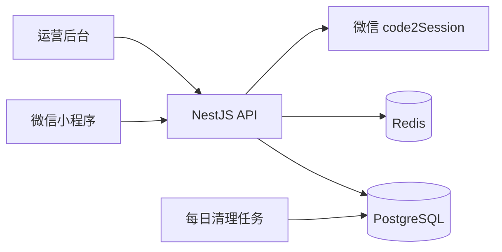

# JIJU · 几句

**无关系链的公共情绪表达空间**

[](https://developers.weixin.qq.com/miniprogram/dev/framework/)
[](https://www.typescriptlang.org/)
[](https://nestjs.com/)
[](https://www.postgresql.org/)
[](LICENSE)

JIJU 是一个面向微信小程序的公共情绪表达空间。用户可以匿名化地发布文字情绪、浏览他人的表达、回应评论，并通过“抱一抱、摸摸头、握拳”表达支持。

项目不提供关注、粉丝、私信、匹配或可点击的陌生人个人主页，重点是通过克制的产品边界降低表达压力。

> 当前仓库包含完整的小程序、API、运营后台、数据库迁移和自动化测试，但尚未完成正式微信凭据联调、HTTPS 合法域名配置及上线合规审批。

## 核心能力

| 模块 | 能力 |
| --- | --- |
| 情绪广场 | 公开内容游标分页、下拉刷新、稳定排序、长文本省略 |
| 帖子 | 发布、详情、编辑、删除、固定到期时间、内容版本 |
| 回应 | 评论发布与删除、固定轻互动切换与取消 |
| 用户 | 微信登录适配、会话恢复、须知确认、个人资料、我的帖子 |
| 安全治理 | 举报、风险确认、内容复核、隐藏/下架/恢复、账号限制、审计 |
| 运营后台 | 独立登录、侧边栏与工作标签、举报和复核队列、内容与用户治理 |
| 工程约束 | 服务端鉴权、幂等键、配额、UTC 时间、字素簇校验、日志脱敏 |

## 技术栈

| 层级 | 方案 |
| --- | --- |
| 小程序 | 微信小程序原生框架 + TypeScript |
| API | Node.js 22+、NestJS 11 |
| 数据访问 | Prisma 6 |
| 数据库 | PostgreSQL 16 |
| 缓存与短时状态 | Redis 7、ioredis |
| 运营后台 | 由 NestJS 服务直接提供的轻量 HTML 工作台 |
| 测试 | Vitest、Jest、Node.js Test Runner、PowerShell 契约校验 |
| 部署 | Docker Compose / Docker 镜像，生产环境建议使用 HTTPS 反向代理 |

## 系统架构



- 小程序与运营后台共用业务 API，但使用独立登录体系和会话。
- PostgreSQL 保存业务事实、内容版本、配额、审核与审计记录。
- Redis 用于会话、幂等短期锁和风险确认 challenge。
- 到期、隐藏和删除状态在读取时强一致过滤，定时任务只负责数据清理兜底。

## 快速开始

### 环境要求

- Node.js 22+
- npm
- Docker Desktop 或 Docker Engine + Compose
- 微信开发者工具

### 1. 获取代码

```bash
git clone https://github.com/Xzm2780/JIJU.git
cd JIJU
```

### 2. 启动 API、PostgreSQL 和 Redis

推荐使用仓库内的 Compose 配置：

```bash
cd server
docker compose up --build
```

启动后：

- API：`http://127.0.0.1:3001/api/v1`
- 标签目录：`http://127.0.0.1:3001/api/v1/tags`
- 运营后台：`http://127.0.0.1:3001/api/v1/admin-console`

Compose 默认生成演示数据，后台演示账号为：

```text
用户名：admin
密码：jiju-admin-demo
```

以上配置只用于本地开发。生产环境必须关闭 mock 微信登录和演示数据，并替换全部默认凭据。

### 3. 启动小程序

1. 用微信开发者工具导入 `frontend/` 目录。
2. 使用你自己的小程序 AppID，或在本地使用测试号。
3. 修改 `frontend/miniprogram/app.ts` 中的 `apiBaseUrl`，使其指向本机 API。

```ts
apiBaseUrl: 'http://<电脑局域网 IP>:3001/api/v1'
```

真机联调时，手机与电脑需处于同一网络。正式发布必须使用已备案且已加入微信合法域名列表的 HTTPS 地址。

`frontend/project.private.config.json` 属于开发者本地配置，已被 Git 忽略，不应提交。

## 本地开发

如本机已提供 PostgreSQL 和 Redis，也可以直接运行 API：

```powershell
cd server
Copy-Item .env.example .env
npm ci
npm run prisma:generate
npm run prisma:migrate
npm run prisma:seed
npm start
```

仅启动基础设施：

```powershell
cd server
docker compose up -d postgres redis
```

### 关键配置

| 环境变量 | 说明 |
| --- | --- |
| `DATABASE_URL` | PostgreSQL 连接串 |
| `REDIS_URL` | Redis 连接串 |
| `MOCK_WECHAT_LOGIN` | 仅非生产环境允许开启；生产环境开启会导致启动失败 |
| `WECHAT_APP_ID` / `WECHAT_APP_SECRET` | 正式微信登录凭据，禁止提交到仓库 |
| `CONTENT_RULES_FILE` | 外置内容规则配置 |
| `IDEMPOTENCY_TTL` | 幂等记录工程 TTL，正式值待数据保留规则确认 |
| `ACCOUNT_DELETION_GRACE_HOURS` | 账号注销冷静期 |
| `SEED_DEMO_DATA` | 是否生成本地演示数据 |

完整配置见 [server/.env.example](server/.env.example) 与 [服务端说明](server/README.md)。

## 测试与验证

完整生产验证入口：

```powershell
powershell -NoProfile -ExecutionPolicy Bypass -File tests/production/Verify-Production.ps1
```

该脚本会执行：

- 后端 Jest 测试与 NestJS 构建
- Prisma schema 校验
- 小程序 TypeScript 检查与 Vitest 测试
- OpenAPI、权限、状态机、AC 矩阵和任务边界校验

分别运行：

```powershell
cd server
npm test
npm run build
```

```powershell
cd frontend
npm run typecheck
npm test
```

需要真实 PostgreSQL/Redis 的集成测试、生产 API 契约测试和环境变量见 [测试说明](tests/README.md) 与 [服务端说明](server/README.md)。缺少数据库、Redis 或微信凭据时，相关用例只能标记为“未验证”，不能计为集成通过。

## 目录结构

```text
JIJU/
├─ docs/                   正式产品、设计、接口和工程契约
├─ frontend/               原生微信小程序
│  ├─ miniprogram/         页面、组件、服务、工具和导航
│  └─ tests/               小程序测试
├─ server/                 NestJS API 与运营后台
│  ├─ src/                 领域模块和公共能力
│  ├─ prisma/              schema、迁移与 seed
│  ├─ scripts/             数据保留和清理任务
│  ├─ config/              外置内容规则
│  └─ test/                真实依赖集成测试
├─ tasks/                  按依赖排序的任务包
├─ tests/                  验收、性能、生产、结构和文档测试
├─ ai-context.md           技术栈与工程规则唯一事实源
└─ domain.md               领域模型与字段约束唯一事实源
```

详细约定见 [ai-context.md](ai-context.md)。

## 文档

| 文档 | 内容 |
| --- | --- |
| [文档索引](docs/README.md) | 全部正式文档入口 |
| [产品需求说明书](docs/product/PRD-v1.2.md) | 正式产品基线与 AC |
| [接口契约](docs/api.yaml) | OpenAPI 3.0 |
| [数据模型](docs/data-model.md) | 实体、字段与索引 |
| [权限矩阵](docs/permissions.md) | 角色与服务端校验点 |
| [帖子状态机](docs/state-machine.md) | 公开、审核和非法迁移 |
| [错误码](docs/errors.md) | HTTP 状态、文案与重试规则 |
| [验收矩阵](docs/ac-matrix.md) | AC 与测试类型 |
| [视觉设计规范](docs/design/ui-guidelines.md) | 颜色、组件和窄屏规则 |

## API 范围

API 根路径为 `/api/v1`，主要包括：

- 登录与注销：`POST /auth/wechat/login`、`POST /auth/logout`
- 广场与帖子：`GET /feed`、`GET /tags`、`GET /posts/{post_id}`
- 内容写入：发布、编辑、删除、评论与轻互动
- 用户功能：须知确认、我的帖子、个人资料、账号注销
- 举报：`POST /reports`
- 后台治理：举报队列、统一复核、内容处置、账号限制和审计查询

完整字段、错误码、幂等和副作用以 [docs/api.yaml](docs/api.yaml) 为准。

## 安全与隐私

- 所有权限、配额、到期过滤、内容可见性和后台角色均由服务端校验。
- 生产环境禁止 mock 微信登录；`session_key` 不返回客户端、不写入日志。
- 日志和埋点不得记录帖子正文、评论正文、举报说明、微信身份、手机号、证件号、令牌或 IP。
- 非作者访问已到期、隐藏、删除或不存在的内容时，统一返回“内容已不可用”。
- 密码仅保存哈希；后台账号、普通用户账号和会话相互隔离。
- 内容规则配置和真实词表不得提交敏感生产配置。

## 上线前检查

以下事项尚未由仓库自身完成，正式上线前必须逐项确认：

- 微信 AppID/AppSecret、code2Session 和真机登录联调。
- HTTPS API 域名、备案和微信合法域名配置。
- 正式用户协议、隐私政策、内容规范和求助资源。
- 正式内容审核词表、阈值与误拦截标准。
- 未成年人保护、数据保留和删除期限的最终审批。
- 专用 PostgreSQL/Redis 环境下的集成测试、压测和容量报告。
- 后台正式账号、密码策略、角色分配和审计流程。
- 微信平台类目、隐私声明和发布审核。

详细阻断项见 [PRD 第 27 节](docs/product/PRD-v1.2.md)。

## 贡献

1. 从 `main` 创建功能分支。
2. 修改前先补充或更新测试。
3. 不新增契约外接口、依赖或客户端权限判断。
4. 提交前运行完整生产验证和文档校验。
5. 不要提交 `.env`、微信凭据、本地开发者配置、日志或真实用户数据。

## License

本项目使用 [MIT License](LICENSE)。
