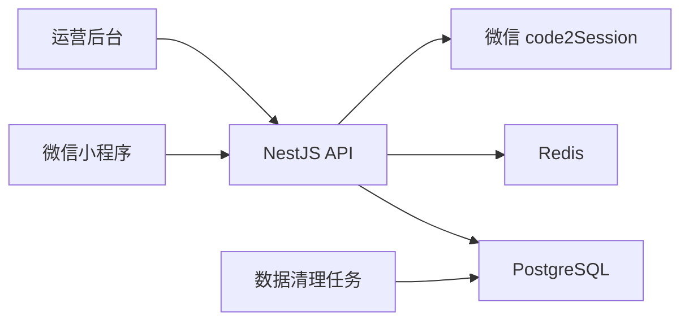

# JIJU · 几句

**一个无关系链的公共情绪表达微信小程序**

[](https://developers.weixin.qq.com/miniprogram/dev/framework/)
[](https://www.typescriptlang.org/)
[](https://nestjs.com/)
[](https://www.postgresql.org/)

JIJU 是一个从产品设计、交互实现到后端治理完整落地的个人项目。

用户可以匿名化地发布文字情绪、浏览他人的表达、发表回应，并通过“抱一抱、摸摸头、握拳”表达支持。产品刻意不提供关注、私信、匹配或陌生人个人主页，以减少关系链带来的表达压力。

## 项目简介 / Overview

- 微信小程序原生前端与 TypeScript。
- NestJS API、PostgreSQL、Redis 和 Prisma。
- 包含用户端与独立运营后台。
- 覆盖发布、评论、互动、举报、内容审核、账号处置和审计流程。
- 以产品需求、接口契约、权限矩阵和验收用例驱动开发。

## 核心功能 / Features

| 模块 | 实现 |
| --- | --- |
| 情绪广场 | 游标分页、刷新、稳定排序、长文本省略 |
| 帖子 | 草稿恢复、标签、留存时长、发布、详情、编辑、删除 |
| 评论与互动 | 评论发布/删除、三类轻互动切换与取消 |
| 用户中心 | 登录会话、使用须知、我的帖子、个人资料、账号设置 |
| 安全治理 | 举报、风险确认、人工复核、内容处置、账号限制、审计 |
| 运营后台 | 独立登录、侧边栏、工作标签、统一待办队列 |

## 技术亮点 / Highlights

- 使用 Unicode 扩展字素簇校验正文长度，并在规则匹配层处理零宽字符。
- 写操作使用 `Idempotency-Key`、数据库唯一约束和事务防止重复提交。
- 帖子公开状态与审核状态分离，并通过内容版本记录编辑和治理历史。
- 轻互动以 `(user_id, post_id)` 唯一约束保证并发下只保留一条有效状态。
- 权限、配额、到期过滤和后台角色全部由服务端校验。
- 日志采用字段白名单，避免记录正文、评论、举报说明和身份凭据。

## 技术栈 / Tech Stack

| 层级 | 技术 |
| --- | --- |
| 小程序 | 微信小程序原生框架、TypeScript |
| 后端 | Node.js 22、NestJS 11 |
| 数据库 | PostgreSQL 16、Prisma 6 |
| 缓存 | Redis 7、ioredis |
| 测试 | Jest、Vitest、Node.js Test Runner |
| 本地环境 | Docker Compose |

## 系统架构 / Architecture



小程序与运营后台共用业务 API，但使用独立身份和会话。PostgreSQL 保存业务记录、内容版本、配额、审核和审计；Redis 用于会话、幂等锁和短期风险确认状态。

## 快速运行 / Quick Start

### 1. 启动后端

需要 Docker Desktop 或 Docker Engine + Compose。

```bash
git clone https://github.com/Xzm2780/JIJU.git
cd JIJU/server
docker compose up --build
```

启动后可访问：

- API：`http://127.0.0.1:3001/api/v1`
- 管理后台：`http://127.0.0.1:3001/api/v1/admin-console`
- 演示账号：`admin` / `jiju-admin-demo`

### 2. 启动小程序

1. 使用微信开发者工具导入 `frontend/`。
2. 配置自己的测试 AppID。
3. 修改 `frontend/miniprogram/app.ts` 中的 `apiBaseUrl`：

```ts
apiBaseUrl: 'http://<电脑局域网 IP>:3001/api/v1'
```

## 测试 / Tests

```powershell
cd server
npm test
npm run build
```

```powershell
cd frontend
npm run typecheck
npm test
```

项目同时包含 OpenAPI、权限矩阵、状态机、AC 矩阵、任务包和文档结构校验。

## 项目结构 / Structure

```text
JIJU/
├─ frontend/            微信小程序与前端测试
├─ server/              NestJS API、运营后台、Prisma 与迁移
├─ docs/                产品、设计、接口和工程契约
├─ tasks/               按依赖拆分的任务包
├─ tests/               契约、性能、结构、文档和综合验证
├─ ai-context.md        技术与工程规则
└─ domain.md            领域实体与字段约束
```

## 文档 / Docs

| 文档 | 内容 |
| --- | --- |
| [文档索引](docs/README.md) | 全部项目文档 |
| [产品需求说明书](docs/product/PRD-v1.3.md) | 产品范围、规则与 AC |
| [OpenAPI 契约](docs/api.yaml) | 接口、错误码、幂等与副作用 |
| [数据模型](docs/data-model.md) | 实体、字段与索引 |
| [权限矩阵](docs/permissions.md) | 角色和服务端校验点 |
| [状态机](docs/state-machine.md) | 公开、审核和非法迁移 |
| [验收矩阵](docs/ac-matrix.md) | 自动化与人工验收用例 |
| [开发流程规范](docs/development-process.md) | 需求、契约、测试、评审与交付门禁 |
| [技术设计文档](docs/technical-design.md) | 架构、模块、数据、流程与技术边界 |

## License

本项目使用 [MIT License](LICENSE)。
