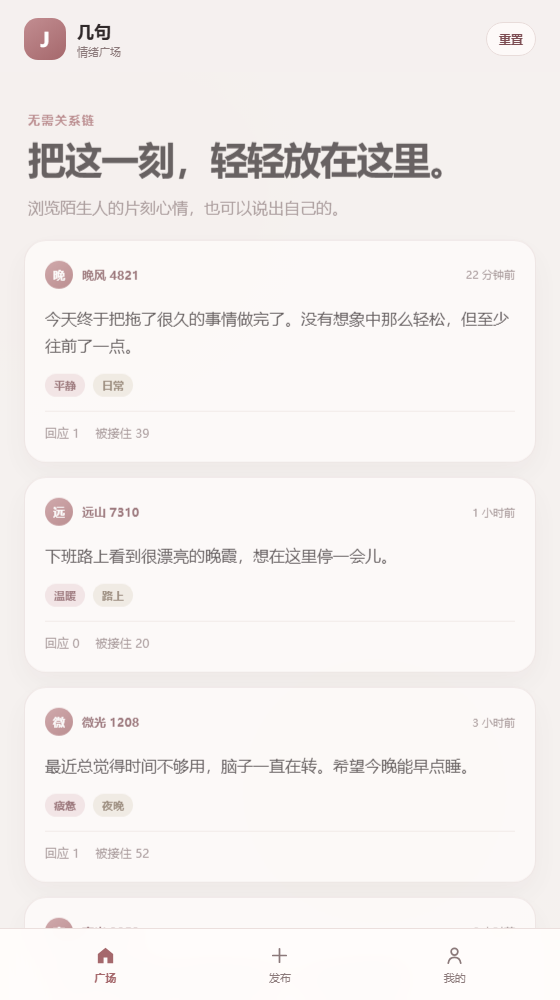

# JIJU · 几句

**无关系链的公共情绪表达空间**

[在线体验](https://raw.githack.com/Xzm2780/JIJU/main/docs/preview/index.html) · [产品文档](docs/README.md) · [GitHub](https://github.com/Xzm2780/JIJU)

<a href="https://raw.githack.com/Xzm2780/JIJU/main/docs/preview/index.html">
  
</a>

JIJU 是一个面向微信生态的情绪表达产品。用户可以发布文字情绪、浏览陌生人的表达、发表回应，并通过“抱一抱、摸摸头、握拳”获得低压力反馈。

产品不提供关注、私信、匹配或陌生人个人主页，内容按 24 小时、3 天或 7 天到期。

<!-- 微信小程序正式版发布后，将小程序码放在 docs/preview/miniprogram-code.png，并在此处加入二维码。 -->

## Access

- H5 交互体验：<https://raw.githack.com/Xzm2780/JIJU/main/docs/preview/index.html>
- 微信小程序：原生微信小程序，代码位于 `frontend/`
- 运营后台：NestJS 内置 HTML 管理后台

## Features

- 情绪广场与游标分页
- 草稿恢复、标签、留存时长和发布
- 评论与三类轻互动
- 我的帖子、个人资料和账号设置
- 举报、复核、内容处置、账号限制与审计

## Tech Stack

微信小程序原生 + TypeScript · NestJS · PostgreSQL · Redis · Prisma

## Run

```bash
cd server
docker compose up --build
```

```powershell
cd frontend
npm run typecheck
npm test
```

## Docs

- [产品需求](docs/product/PRD-v1.3.md)
- [技术设计](docs/technical-design.md)
- [接口契约](docs/api.yaml)
- [开发流程](docs/development-process.md)

## License

[MIT](LICENSE)
