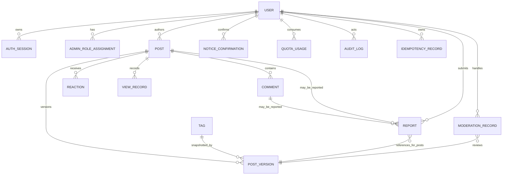

# JIJU 数据模型

## 1. 范围与来源

本文依据：

- 根目录 `domain.md`；当前仓库不存在 `docs/domain.md`。
- `docs/state-machine.md`
- `docs/permissions.md`
- `docs/errors.md`
- `docs/api.yaml`

本文描述逻辑数据模型、约束、索引、事务边界和 API 暴露规则，不绑定数据库产品，不包含 SQL 或业务实现代码。

## 2. 模型原则

1. 公开状态与审核状态分开保存，不能用一个状态字段表达两种维度。（依据：domain.md、state-machine.md）
2. 内容版本不可原地覆盖。帖子每次成功编辑都生成不可变内容版本，举报和复核记录必须保留被处理版本引用。（依据：domain.md Post、Report、ModerationRecord）
3. 用户可见计数可以是派生值或缓存值，但必须能由 Reaction、Comment、ViewRecord 等事实数据校验，不得因重复请求产生重复计数。
4. 所有业务时间使用 UTC 存储；自然日和解除时间在服务端按北京时间判断，展示层再格式化。（依据：domain.md）
5. 软删除表示业务不可见并保留审计关联，不代表已经确定物理清理期限。所有保留期限仍需产品、法务和隐私负责人确认。
6. 服务端所有写请求先校验 `Idempotency-Key`；详情浏览使用独立的 `X-View-Token` 去重，两者不可混用。（依据：docs/api.yaml）

## 3. 实体关系

关系说明：

- Post 与 Report、ModerationRecord 之间通过 `target_type`、`target_id` 和 `content_version` 关联；评论不编辑，但其举报仍记录 `content_version=1`。
- Tag 名称在帖子版本中保存快照，标签重命名或停用不能改变历史帖子语义。
- ViewRecord 不展示浏览者身份；非作者响应不能通过组合多个字段推断浏览者。

## 4. 核心实体

### 4.1 User

| 字段 | 逻辑类型 | 必填 | 约束与说明 |
| --- | --- | --- | --- |
| id | 不透明 ID | 是 | 服务端生成，唯一。 |
| auth_subject_ref | 内部敏感主体引用 | 是 | 正式微信由服务端对 openid 做不可逆摘要；唯一，不对外返回，不进入日志或埋点。 |
| auth_provider | 枚举 | 是 | `WECHAT` 或 `MOCK`；正式环境只允许 WECHAT，MOCK 仅非生产。 |
| plaza_nickname | 字符串 | 是 | 服务端生成；不要求唯一；不得以微信昵称或头像替代。 |
| bio | 字符串 | 否 | 个人简介，最多 80 个扩展字素簇。 |
| avatar_color | 枚举 | 是 | ROSE、SAGE、SAND、LAVENDER、SKY；用于生成不包含微信头像的本地头像。 |
| account_status | 枚举 | 是 | 至少支持正常和封禁；最终枚举待确认。 |
| posting_restricted_until | UTC 时间 | 否 | 发帖限制解除时间。 |
| commenting_restricted_until | UTC 时间 | 否 | 评论限制解除时间。 |
| reaction_restricted_until | UTC 时间 | 否 | 互动限制解除时间。 |
| deactivated_at | UTC 时间 | 否 | 账号注销标记；保留和物理清理期限待确认。 |
| account_deletion_scheduled_at | UTC 时间 | 否 | 注销冷静期结束和计划清理时间；默认请求后 30 天。 |

主要约束：`auth_subject_ref` 唯一；公开 API 只能返回 `id` 和 `plaza_nickname` 的必要子集。openid、unionid、session_key 不落库。

### 4.2 AuthSession

| 字段 | 逻辑类型 | 必填 | 约束与说明 |
| --- | --- | --- | --- |
| id | 不透明 ID | 是 | 唯一。 |
| user_id | 用户 ID | 是 | 关联 User。 |
| token_hash | 哈希字符串 | 是 | 只保存令牌哈希，不保存可回放的明文令牌。 |
| expires_at | UTC 时间 | 是 | 会话到期时间。 |
| revoked_at | UTC 时间 | 否 | 注销或安全撤销时间。 |
| created_at | UTC 时间 | 是 | 会话创建时间。 |
| last_seen_at | UTC 时间 | 否 | 用于会话活跃判断；不得记录敏感请求体。 |

主要索引：`(user_id, revoked_at)`、`(expires_at)`。

### 4.3 AdminRoleAssignment

| 字段 | 逻辑类型 | 必填 | 约束与说明 |
| --- | --- | --- | --- |
| id | 不透明 ID | 是 | 唯一。 |
| user_id | 用户 ID | 是 | 关联 User。 |
| role | 枚举 | 是 | REPORT_REVIEWER、CONTENT_MODERATOR、ACCOUNT_MODERATOR、AUDITOR、CONFIG_ADMIN。 |
| scope | 字符串或资源范围 | 否 | 限定后台可处理的数据范围。 |
| active | 布尔 | 是 | 是否有效。 |
| created_at | UTC 时间 | 是 | 授权时间。 |
| revoked_at | UTC 时间 | 否 | 撤销时间。 |

主要约束：同一用户、同一角色、同一范围不应存在重复有效授权。

### 4.3.1 AdminCredential

| 字段 | 逻辑类型 | 必填 | 约束与说明 |
| --- | --- | --- | --- |
| id | 不透明 ID | 是 | 唯一。 |
| user_id | 用户 ID | 是 | 与 AdminRoleAssignment 指向同一运营账号；一对一唯一。 |
| username | 登录名 | 是 | 全局唯一，仅用于后台登录。 |
| password_hash | scrypt 哈希 | 是 | `scrypt$salt$hash`，不得保存明文或可逆密码。 |
| active | 布尔 | 是 | 停用后不能发起新的后台登录。 |
| created_at、updated_at | UTC 时间 | 是 | 凭据创建与更新时间。 |

后台会话仍使用 AuthSession 保存令牌哈希，权限仍由 AdminRoleAssignment 决定；密码只用于登录，不直接承载权限。

### 4.4 Post

| 字段 | 逻辑类型 | 必填 | 约束与说明 |
| --- | --- | --- | --- |
| id | 不透明 ID | 是 | 服务端生成，唯一。 |
| author_id | 用户 ID | 是 | 关联 User。 |
| body_text | 字符串 | 是 | 当前公开版本正文，1 至 500 个扩展字素簇。 |
| body_grapheme_length | 整数 | 是 | 按 Unicode 扩展字素簇计算。 |
| emotion_tag_id | 标签 ID | 否 | 最多一个。 |
| emotion_tag_name_snapshot | 字符串 | 否 | 与 emotion_tag_id 同时存在。 |
| context_tag_id | 标签 ID | 否 | 最多一个。 |
| context_tag_name_snapshot | 字符串 | 否 | 与 context_tag_id 同时存在。 |
| retention_hours | 枚举 | 是 | 24、72、168；客户端默认预选 168，API 必须显式提交，服务端不隐式补值。 |
| public_status | 枚举 | 是 | PUBLISHED、HIDDEN、EXPIRED、DELETED；DRAFT 只存在客户端。 |
| moderation_status | 枚举 | 是 | PASSED、PENDING、REJECTED。 |
| risk_confirmed_at | UTC 时间 | 条件 | PENDING 且继续公开时必填。 |
| published_at | UTC 时间 | 是 | 发布成功时生成，编辑不变。 |
| expires_at | UTC 时间 | 是 | 发布成功时固定，编辑和访问不延长。 |
| current_content_version | 整数 | 是 | 从 1 开始，成功编辑后递增。 |
| edited_at | UTC 时间 | 否 | 最近成功编辑时间。 |
| hidden_at | UTC 时间 | 否 | 下架时间。 |
| deleted_at | UTC 时间 | 否 | 作者删除时间；业务不可恢复。 |

主要索引：

- 广场：`(public_status, moderation_status, published_at DESC, id DESC)`。
- 作者列表：`(author_id, public_status, published_at DESC, id DESC)`。
- 到期：`(expires_at, public_status)`。
- 内容版本并发：以 `id + current_content_version` 作为更新条件。
- 帖子详情和作者帖子列表必须向作者返回 `content_version`，供编辑请求携带 `expected_content_version`；广场列表不返回。

### 4.5 PostVersion

PostVersion 是支撑编辑历史、举报版本和审核快照的内部实体，不作为公开资源单独暴露。

| 字段 | 逻辑类型 | 必填 | 约束与说明 |
| --- | --- | --- | --- |
| id | 不透明版本 ID | 是 | 唯一。 |
| post_id | 帖子 ID | 是 | 关联 Post。 |
| version_number | 整数 | 是 | 从 1 开始递增。 |
| body_text | 字符串 | 是 | 该版本完整正文。 |
| body_grapheme_length | 整数 | 是 | 按扩展字素簇计算。 |
| emotion_tag_id | 标签 ID | 否 | 版本快照。 |
| emotion_tag_name_snapshot | 字符串 | 否 | 版本快照。 |
| context_tag_id | 标签 ID | 否 | 版本快照。 |
| context_tag_name_snapshot | 字符串 | 否 | 版本快照。 |
| created_at | UTC 时间 | 是 | 版本生成时间。 |

主要约束：

- `(post_id, version_number)` 唯一。
- PostVersion 只追加，不更新旧版本正文。
- Report 对帖子举报时关联该版本的 `version_number` 和稳定版本 ID。

### 4.6 Comment

| 字段 | 逻辑类型 | 必填 | 约束与说明 |
| --- | --- | --- | --- |
| id | 不透明 ID | 是 | 唯一。 |
| post_id | 帖子 ID | 是 | 关联 Post。 |
| author_id | 用户 ID | 是 | 评论作者。 |
| body_text | 字符串 | 是 | 1 至 200 个扩展字素簇。 |
| body_grapheme_length | 整数 | 是 | 按扩展字素簇计算。 |
| content_version | 整数 | 是 | 评论不编辑，固定为 1。 |
| moderation_status | 枚举 | 是 | PASSED、PENDING、REJECTED。 |
| published_at | UTC 时间 | 是 | 评论发布时间。 |
| deleted_at | UTC 时间 | 否 | 作者删除时间。 |

主要索引：`(post_id, published_at, id)`；`(author_id, published_at, id)`。

### 4.7 Reaction

| 字段 | 逻辑类型 | 必填 | 约束与说明 |
| --- | --- | --- | --- |
| id | 不透明 ID | 是 | 唯一。 |
| user_id | 用户 ID | 是 | 互动用户。 |
| post_id | 帖子 ID | 是 | 目标帖子。 |
| reaction_type | 枚举 | 是 | HUG、HEAD_PAT、CHEER。 |
| active | 布尔 | 是 | 取消时为 false，不物理删除。 |
| created_at | UTC 时间 | 是 | 首次创建时间。 |
| updated_at | UTC 时间 | 是 | 切换或取消时间。 |

主要约束：

- `(user_id, post_id)` 唯一。
- 分类计数只统计 `active=true`。
- 切换类型更新同一记录，不能创建第二条有效互动。

主要索引：`(post_id, reaction_type, active)`。

### 4.8 Report

| 字段 | 逻辑类型 | 必填 | 约束与说明 |
| --- | --- | --- | --- |
| id | 不透明 ID | 是 | 唯一。 |
| reporter_id | 用户 ID | 是 | 举报人，仅后台内部使用。 |
| target_type | 枚举 | 是 | POST 或 COMMENT。 |
| target_id | 不透明 ID | 是 | 被举报对象。 |
| content_version | 整数 | 是 | 服务端在提交时捕获，不接受客户端指定。 |
| reason | 枚举 | 是 | 辱骂/攻击/骚扰、隐私、未成年人、危险或不适当、广告或垃圾信息、其他。 |
| other_description | 字符串 | 条件 | reason=OTHER 时必填；仅后台可见。 |
| is_minor_related | 布尔 | 是 | reason=MINOR_INVOLVED 时为 true。 |
| priority | 枚举 | 是 | PREEMPTIVE 或 NORMAL。 |
| priority_rank | 整数 | 是 | 队列内部排序投影：PREEMPTIVE=0，NORMAL=1；不返回客户端。 |
| status | 枚举 | 是 | PENDING、PROCESSING、RESOLVED。 |
| dedupe_key | 字符串 | 是 | 唯一；覆盖同用户、同对象、同原因的 24 小时去重窗口。 |
| submitted_at | UTC 时间 | 是 | 提交时间。 |

主要索引：`(status, priority_rank, submitted_at, id)`；`(target_type, target_id, content_version)`；`(is_minor_related, priority_rank, status)`。

### 4.9 Tag

| 字段 | 逻辑类型 | 必填 | 约束与说明 |
| --- | --- | --- | --- |
| id | 不透明 ID | 是 | 稳定 ID，唯一。 |
| category | 枚举 | 是 | EMOTION 或 CONTEXT。 |
| name | 字符串 | 是 | 同一分类内不重复。 |
| sort_order | 整数 | 是 | 选择器排序。 |
| enabled | 布尔 | 是 | 停用后不可用于新帖子。 |
| is_other | 布尔 | 是 | 每个分类最多一个“其他”固定标签。 |
| created_at | UTC 时间 | 是 | 创建时间。 |
| updated_at | UTC 时间 | 是 | 最近变更时间。 |

主要约束：`(category, name)` 唯一；停用不删除，历史帖子依赖快照。

### 4.9.1 TagCatalog

| 字段 | 逻辑类型 | 必填 | 约束与说明 |
| --- | --- | --- | --- |
| id | 固定标识 | 是 | 固定为 current 的目录配置记录。 |
| version | 字符串 | 是 | 标签目录版本；标签新增、停用、重命名或排序变化时更新。 |
| updated_at | UTC 时间 | 是 | 最近配置变更时间。 |

`GET /tags` 返回该版本和所有启用标签。发布接口仍按标签 ID 重新校验分类和启用状态，不接受仅凭旧版本通过。

### 4.10 NoticeConfirmation

| 字段 | 逻辑类型 | 必填 | 约束与说明 |
| --- | --- | --- | --- |
| id | 不透明 ID | 是 | 唯一。 |
| user_id | 用户 ID | 是 | 确认用户。 |
| notice_version | 字符串 | 是 | 协议版本。 |
| confirmed_at | UTC 时间 | 是 | 确认时间。 |

主要约束：`(user_id, notice_version)` 唯一。

### 4.11 QuotaUsage

| 字段 | 逻辑类型 | 必填 | 约束与说明 |
| --- | --- | --- | --- |
| id | 不透明 ID | 是 | 唯一。 |
| user_id | 用户 ID | 是 | 配额所属用户。 |
| quota_type | 枚举 | 是 | POST_DAILY 或 COMMENT_ROLLING_60M。 |
| request_id | 字符串 | 是 | 成功请求的幂等标识。 |
| source_id | 不透明 ID | 是 | 成功生成的 Post 或 Comment ID。 |
| consumed_at | UTC 时间 | 是 | 成功写入时间。 |

主要约束：

- `(user_id, quota_type, request_id)` 唯一。
- `(user_id, quota_type, source_id)` 唯一。
- 失败、校验失败、网络失败和幂等重放不得新增记录。

主要索引：`(user_id, quota_type, consumed_at)`。

### 4.12 ModerationRecord

| 字段 | 逻辑类型 | 必填 | 约束与说明 |
| --- | --- | --- | --- |
| id | 不透明 ID | 是 | 唯一。 |
| target_type | 枚举 | 是 | POST 或 COMMENT。 |
| target_id | 不透明 ID | 是 | 被复核对象。 |
| content_version | 整数 | 是 | 被处理内容版本。 |
| review_round | 整数 | 是 | 内容版本内的复核轮次。 |
| priority | 枚举 | 是 | PREEMPTIVE 或 NORMAL。 |
| priority_rank | 整数 | 是 | 队列内部排序投影：PREEMPTIVE=0，NORMAL=1；不返回客户端。 |
| status | 枚举 | 是 | PENDING、PROCESSING、RESOLVED。 |
| hit_rule_refs | 规则引用列表 | 否 | 命中规则引用，不复制规则正文。 |
| action | 枚举 | 否 | HIDE、TAKEDOWN、RESTORE 或无动作。 |
| public_status_before | 枚举 | 条件 | 有公开状态变更时必填。 |
| public_status_after | 枚举 | 条件 | 有公开状态变更时必填。 |
| moderation_status_before | 枚举 | 条件 | 有审核状态变更时必填。 |
| moderation_status_after | 枚举 | 条件 | 有审核状态变更时必填。 |
| handled_by | 用户 ID | 条件 | 完成处理时必填。 |
| handled_at | UTC 时间 | 条件 | 完成处理时必填。 |
| reason | 字符串 | 条件 | 处理动作需要时必填。 |
| created_at | UTC 时间 | 是 | 待审记录创建时间。 |

主要约束：`(target_type, target_id, content_version, review_round)` 唯一。

主要索引：`(status, priority_rank, created_at, id)`；`(target_type, target_id, content_version)`。

### 4.13 AuditLog

| 字段 | 逻辑类型 | 必填 | 约束与说明 |
| --- | --- | --- | --- |
| id | 不透明 ID | 是 | 唯一。 |
| actor_id | 用户 ID | 是 | 操作者。 |
| actor_role | 字符串 | 是 | 操作时角色快照。 |
| action_type | 字符串 | 是 | 治理或配置动作类型。 |
| object_type | 枚举 | 是 | CONTENT、REPORT、ACCOUNT、MODERATION_RULE、TAG、RATE_LIMIT、CRISIS_RESOURCE。 |
| object_id | 不透明 ID | 是 | 目标对象。 |
| content_version | 整数 | 条件 | 对象为内容时必填。 |
| state_before | 状态快照 | 条件 | 有状态变化时必填，不保存内容正文。 |
| state_after | 状态快照 | 条件 | 有状态变化时必填，不保存内容正文。 |
| reason | 字符串 | 条件 | 治理动作需要时必填。 |
| request_id | 字符串 | 是 | 请求追踪标识。 |
| occurred_at | UTC 时间 | 是 | 发生时间。 |

主要约束：只追加，不修改已写审计记录；主要索引 `(object_type, object_id, occurred_at)`、`(actor_id, occurred_at)`。

### 4.13.1 ReviewQueue 查询投影

`GET /admin/review-queue` 只读投影 `Report` 与 `ModerationRecord` 两张事实表，不新增第三张联合事实表。投影按 `priority_rank`、入队时间、来源稳定顺序和 `item_id` 形成不透明游标；`source=all` 时不得因跨来源同时间戳而漏项或重复。响应只包含来源、队列项 ID、目标类型与 ID、内容版本、优先级、状态、原因代码/命中规则引用、未成年人标记和入队时间，不包含正文、举报说明、浏览量或浏览者身份。

### 4.14 ViewRecord

| 字段 | 逻辑类型 | 必填 | 约束与说明 |
| --- | --- | --- | --- |
| id | 不透明 ID | 是 | 唯一。 |
| post_id | 帖子 ID | 是 | 被查看帖子。 |
| viewer_id | 用户 ID | 否 | 可空；仅内部计数和作者排除，不对外展示。 |
| view_token | 字符串 | 是 | 单次新详情页访问标识。 |
| viewed_at | UTC 时间 | 是 | 成功计入浏览的时间。 |

主要约束：

- `(post_id, view_token)` 唯一。
- 同一用户从广场重新打开新的详情页可以形成新记录。
- 作者本人访问、失败访问、内容不可用和自动化巡检不写入。

主要索引：`(post_id, viewed_at)`。

### 4.15 IdempotencyRecord

IdempotencyRecord 是写接口可靠重试的内部支撑实体，不对外暴露。

| 字段 | 逻辑类型 | 必填 | 约束与说明 |
| --- | --- | --- | --- |
| id | 不透明 ID | 是 | 唯一。 |
| actor_id | 用户 ID | 是 | 发起写操作的用户。 |
| operation | 字符串 | 是 | 如 post.publish、comment.publish、report.submit。 |
| idempotency_key | 字符串 | 是 | `v1:<operation>:<uuid_v7>`。 |
| request_fingerprint | 字符串 | 是 | 规范化业务载荷指纹，不保存正文明文。 |
| status | 枚举 | 是 | PROCESSING、SUCCEEDED、FAILED_CONFLICT。 |
| response_ref | 字符串或响应快照 | 否 | 同键同载荷重放所需的安全结果引用。 |
| created_at | UTC 时间 | 是 | 首次接收时间。 |
| expires_at | UTC 时间 | 是 | 幂等记录清理时间；具体保留期待确认。 |

主要约束：`(actor_id, operation, idempotency_key)` 唯一。同键不同载荷返回 `JIJU_CONFLICT_4091`，不得执行第二次副作用。

### 4.16 ModerationChallenge

ModerationChallenge 是发布规则的短期确认挑战，保存在 Redis，不进入公开数据。

| 字段 | 逻辑类型 | 必填 | 约束与说明 |
| --- | --- | --- | --- |
| id | 不透明挑战 ID | 是 | UUIDv7，Redis 键。 |
| user_id | 用户 ID | 是 | 挑战只能由同一用户消费。 |
| content_fingerprint | 字符串 | 是 | 绑定正文、标签、留存和规则结果。 |
| prompt_version | 字符串 | 是 | 用户看到的提示版本。 |
| resource_version | 字符串 | 是 | 外部求助资源版本。 |
| expires_at | UTC 时间 | 是 | 短期配置 TTL 到期后不可使用。 |
| consumed_at | UTC 时间 | 否 | 成功后标记消费，防重复使用。 |

首次 `CONFIRM` 只创建挑战，不创建 Post。确认重试必须校验 challenge_id、用户、内容指纹和 `risk_acknowledged=true`；成功后创建 PENDING Post。

## 5. 计数模型

| 计数 | 事实来源 | 规则 |
| --- | --- | --- |
| comment_count | Comment | 只统计未删除且允许展示的评论；删除减一且不得为负。 |
| reaction_counts | Reaction | 只统计 active=true，按三种固定类型聚合；切换保持总数不变。 |
| view_count | ViewRecord | 详情访问次数，不是独立人数；只通过作者帖子详情 API 返回。 |
| report_queue_count | Report | 按状态和优先级聚合，仅后台可见。 |

计数缓存如存在，必须在与业务事实相同的事务或可恢复流程中更新，并定期通过事实表校验。

## 6. 事务边界

| 操作 | 同一事务内必须完成 | 事务后允许异步完成 |
| --- | --- | --- |
| 发布 | 创建 Post、首个 PostVersion、成功 QuotaUsage、幂等结果 | 高风险内容队列通知 |
| 编辑 | 追加 PostVersion、更新 Post 当前版本和编辑时间、必要时更新审核状态、幂等结果 | 新版本复核队列通知 |
| 删除帖子 | 检查作者和状态、更新 public_status/deleted_at、写幂等结果 | 审计归档任务 |
| 提交评论 | 创建 Comment、成功 QuotaUsage、计数更新、幂等结果 | 高风险内容队列通知 |
| 删除评论 | 标记 deleted、计数减一、写幂等结果 | 审计归档任务 |
| 轻互动设值 | 唯一 Reaction 的创建/切换、分类计数、幂等结果 | 统计汇总 |
| 取消轻互动 | active=false、分类计数减一、幂等结果 | 统计汇总 |
| 提交举报 | 快照 content_version、创建 Report、去重键、幂等结果 | 队列通知 |
| 内容复核 | 条件更新审核状态、必要时公开状态、ModerationRecord、审计、幂等结果 | 通知和报表 |
| 内容治理动作 | 条件更新状态、ModerationRecord、审计、幂等结果 | 缓存失效和通知 |
| 浏览计数 | ViewRecord 唯一写入与浏览量聚合同步完成 | 分析汇总 |

任何事务都不得留下公开可见的半成品内容。

## 7. 并发与幂等

- 写请求使用 `Idempotency-Key`，服务端作用域至少为“用户 + 操作 + 键”。
- Post 编辑和治理以 `expected_content_version` 做条件更新；版本不一致返回 `JIJU_CONFLICT_4092`。
- Reaction 依赖 `(user_id, post_id)` 唯一约束处理并发；切换和取消必须在事务内更新计数。
- 举报同时依赖 IdempotencyRecord 和 24 小时业务去重键。
- ViewRecord 依赖 `(post_id, view_token)` 唯一约束，同一详情页刷新不重复计数。

## 8. API 数据暴露

| 数据 | 普通公开响应 | 作者响应 | 后台响应 |
| --- | --- | --- | --- |
| 帖子正文 | 有效公开帖子返回 | 返回本人有效或历史视图允许内容 | 仅治理所需内容版本 |
| 评论正文 | 有效帖子下未删除评论 | 同公开规则 | 仅举报或复核关联版本 |
| 举报说明 | 不返回 | 不返回 | 仅授权举报/复核角色 |
| view_count | 不返回 | 仅作者帖子详情接口返回 | 本次 API 范围不返回 |
| 浏览者身份 | 不返回 | 不返回 | 不返回 |
| openid、unionid、session_key | 不返回 | 不返回 | 不返回 |
| 后台审计字段 | 不返回 | 不返回 | 授权审计角色可见 |

`GET /tags` 只公开标签版本、稳定 ID、名称、分类和排序；不得返回内部规则、停用标签或审核配置。

本次 API 设计要求只有作者帖子详情返回浏览量，因此“我的帖子列表”不返回 `view_count`。如果产品坚持在列表展示浏览量，必须单独调整接口范围和权限约定。

## 9. 软删除与保留

| 实体 | 删除方式 | 当前可见性 |
| --- | --- | --- |
| User | deactivated_at + account_deletion_scheduled_at | 立即停用；30 天后匿名化身份并清空业务正文，保留匿名账号行支撑审计关联 |
| Post | public_status=DELETED 且 deleted_at | 所有用户端不可见 |
| Comment | deleted_at | 所有用户端列表不展示 |
| Reaction | active=false | 不计入任何互动数量 |
| Report | 不提供用户删除 | 后台处理状态变化；按已批准的保留任务和数据规则处置 |
| Tag | enabled=false | 历史快照继续展示 |
| ViewRecord | 保留任务按 viewed_at 清理 | 默认保留 30 天 |
| ModerationRecord、AuditLog | 不提供用户删除 | 默认保留 180 天；审计只追加 |

已确认的配置默认：

- `IDEMPOTENCY_TTL`：24 小时。
- `ACCOUNT_DELETION_GRACE_HOURS`：720 小时（30 天）。
- `EXPIRED_POST_BODY_RETENTION_DAYS`：到期后 30 天清理正文标签快照。
- `VIEW_RECORD_RETENTION_DAYS`：30 天。
- `AUDIT_LOG_RETENTION_DAYS`：180 天。

保留任务由外部每日调度执行 `npm run retention:run`；查询时业务过滤仍是强一致规则，不依赖定时任务。

## 10. 待确认事项

1. 独立内容版本实体 `PostVersion` 的最终物理存储方案需要随数据库选型确认；逻辑模型不得退化为覆盖历史正文。
2. `RESTORE` 契约已批准为后台有条件动作：仅 `CONTENT_MODERATOR` 可将 `HIDDEN` 恢复为 `PUBLISHED`，要求服务端当前时间早于 `expires_at`、未删除、审核状态非 `REJECTED`，记录审计且不得延长 `expires_at`。动作实现属于 T12，不在 B0 实现。
3. 账号注销、帖子到期、帖子删除、举报、审计、浏览记录和幂等记录的具体保留期限与物理清理策略仍未确认。
4. 用户关于“只有作者帖子详情可返回浏览量”的当前 API 约束与 PRD 中“我的”列表展示浏览量的描述存在潜在差异；如需在列表展示，必须重新确认 API 暴露范围。
5. 后台角色枚举已冻结；具体人员授权、角色组合和数据范围仍需运营确认。
6. `IDEMPOTENCY_TTL` 和账号注销期限已按项目负责人授权的配置默认实现；正式上线前仍须完成隐私政策文本复核。
