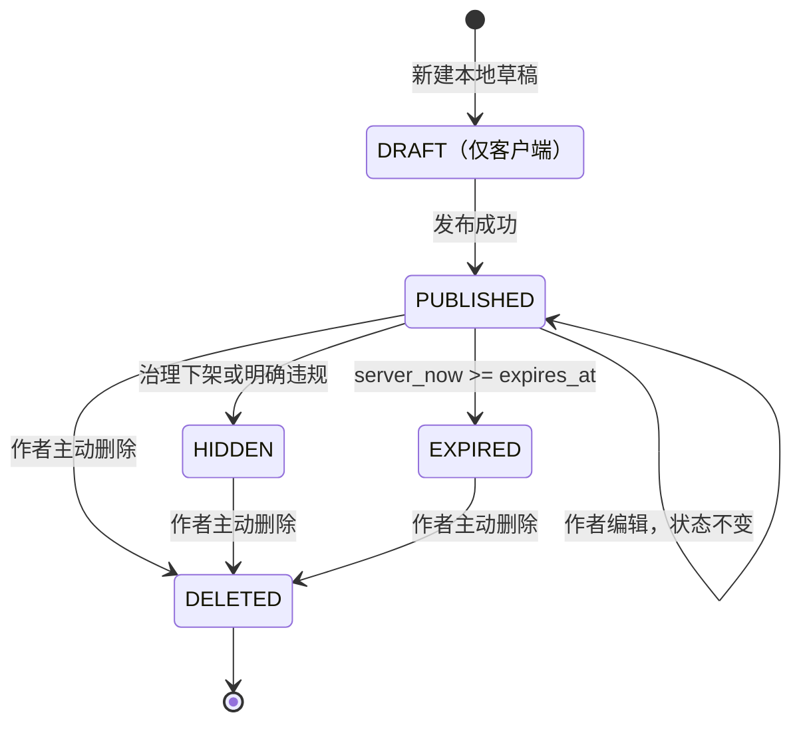
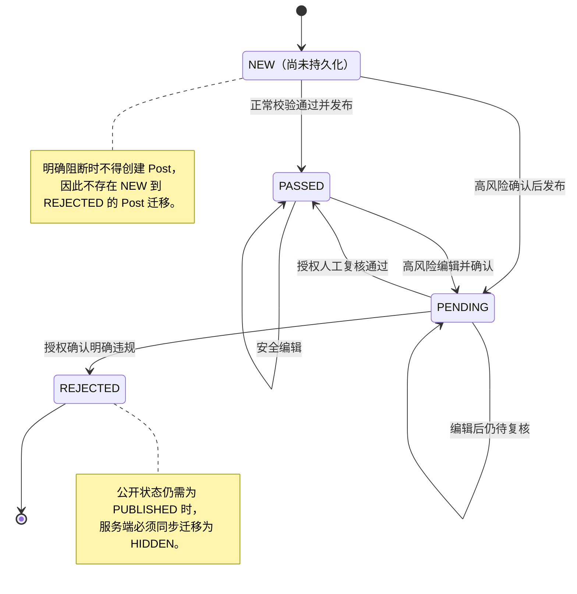

# JIJU Post 状态机

## 1. 范围与依据

本文依据：

- 仓库现有领域模型 `domain.md` 中 Post、ModerationRecord 及相关字段。
- `docs/product/PRD-v1.1.md` 第 5.6 节“帖子状态”。
- `docs/product/PRD-v1.1.md` 第 5.7 节“编辑与版本”。
- `docs/product/PRD-v1.1.md` 第 7.6 节“到期、删除和治理”。

当前仓库不存在 `docs/domain.md`，因此以根目录 `domain.md` 为准。本文不引入第 5.6、5.7、7.6 节以外的治理恢复规则。

Post 使用两个独立状态维度：

- 公开状态 `public_status`：`DRAFT`、`PUBLISHED`、`HIDDEN`、`EXPIRED`、`DELETED`。
- 审核状态 `moderation_status`：`PASSED`、`PENDING`、`REJECTED`。
- `DRAFT` 只存在于客户端；服务端 Post 从成功发布开始持久化。
- 服务端时间满足 `server_now >= expires_at` 时，公开状态才可从 `PUBLISHED` 进入 `EXPIRED`。

## 2. Post 公开状态迁移

### 2.1 允许的迁移

| 当前状态 | 触发动作 | 允许条件 | 目标状态 | 副作用 | 依据 |
| --- | --- | --- | --- | --- | --- |
| DRAFT（仅本地） | 首次发布 | 已登录；当前须知已确认；正文等内容校验通过；配额未满 | PUBLISHED | 服务端创建 Post；生成稳定 ID、`published_at` 和固定 `expires_at`；写入首个内容版本；成功消耗发帖配额；正常通过时审核状态为 PASSED，命中允许发布的高风险规则并确认时审核状态为 PENDING | PRD 5.6；domain.md Post |
| PUBLISHED | 作者安全编辑 | 作者本人；帖子仍有效；内容校验通过；不命中需重新复核的高风险规则 | PUBLISHED（保持） | 不改变 ID、`published_at`、`expires_at`；生成新内容版本并更新 `current_content_version`、`edited_at` | PRD 5.7；domain.md Post |
| PUBLISHED | 作者高风险编辑 | 作者本人；帖子仍有效；内容校验通过；用户确认高风险提示 | PUBLISHED（保持） | 生成新内容版本；更新 `edited_at`；写入 `risk_confirmed_at`；审核状态转为 PENDING 并重新进入人工复核 | PRD 5.7；domain.md Post |
| PUBLISHED | 治理下架 | 命中治理规则，或经授权的运营人员执行下架 | HIDDEN | 写入 `hidden_at`；广场和详情均不可见；作者在“我的”看到已下架；记录处理人员、时间、原因和前后状态 | PRD 5.6、7.6；domain.md Post、ModerationRecord |
| PUBLISHED | 到期处理 | 服务端时间满足 `server_now >= expires_at` | EXPIRED | 从公开区域移除；禁止新增评论和轻互动；作者仍可查看历史内容；不改写 `expires_at` | PRD 5.6、7.6；domain.md Post |
| PUBLISHED | 作者主动删除 | 请求者是作者；删除请求具备幂等标识 | DELETED | 立即从公开区域移除；写入 `deleted_at`；作者不可在“我的”查看；保留审计关联 | PRD 5.6、7.6；domain.md Post |
| HIDDEN | 作者主动删除 | 请求者是作者；删除请求具备幂等标识 | DELETED | 写入 `deleted_at`；作者不可在“我的”查看 | PRD 5.6；domain.md Post |
| EXPIRED | 作者主动删除 | 请求者是作者；删除请求具备幂等标识 | DELETED | 写入 `deleted_at`；作者不可在“我的”查看 | PRD 5.6；domain.md Post |

`PUBLISHED -> PUBLISHED` 的编辑属于状态内更新，不是公开生命周期迁移。重复提交同一幂等操作应返回首次结果；不得因为“源状态与目标状态相同”而重复生成版本或消耗配额。

### 2.2 公开状态迁移矩阵

| 当前状态 → 目标状态 | DRAFT | PUBLISHED | HIDDEN | EXPIRED | DELETED |
| --- | --- | --- | --- | --- | --- |
| DRAFT | 仅客户端编辑 | 允许 | 禁止 | 禁止 | 禁止服务端迁移 |
| PUBLISHED | 禁止 | 编辑时保持 | 允许 | 到期时允许 | 作者删除时允许 |
| HIDDEN | 禁止 | 禁止 | 重复下架时保持 | 禁止 | 作者删除时允许 |
| EXPIRED | 禁止 | 禁止 | 禁止 | 重复到期检查时保持 | 作者删除时允许 |
| DELETED | 禁止 | 禁止 | 禁止 | 禁止 | 幂等重复删除，不迁移 |

矩阵中的“保持”只用于幂等重放或编辑更新；不得据此绕过权限、内容校验或版本冲突检查。

## 3. 审核状态迁移

### 3.1 允许的迁移

| 当前状态 | 触发动作 | 允许条件 | 目标状态 | 副作用 | 依据 |
| --- | --- | --- | --- | --- | --- |
| NEW（尚未持久化） | 正常发布 | 内容校验结果为通过，满足 PRD 5.6 的全部发布条件 | PASSED | 创建审核结果为 PASSED 的 Post；内容可公开 | PRD 5.6；domain.md Post |
| NEW（尚未持久化） | 高风险内容发布 | 命中允许发布但需人工复核的规则；用户已确认风险提示 | PENDING | 创建审核结果为 PENDING 的 Post；写入 `risk_confirmed_at`；内容可继续展示并进入复核队列 | PRD 5.6；domain.md Post |
| PASSED | 作者安全编辑 | 作者本人；帖子仍处于 PUBLISHED；内容校验通过 | PASSED（保持） | 更新内容版本；不创建复核任务 | PRD 5.7 |
| PASSED | 作者高风险编辑 | 作者本人；帖子仍处于 PUBLISHED；内容校验通过；用户确认高风险提示 | PENDING | 更新内容版本；写入新的 `risk_confirmed_at`；重新进入人工复核 | PRD 5.7；domain.md Post |
| PENDING | 内容再次编辑后仍待审 | 作者本人；帖子仍处于 PUBLISHED；编辑内容校验通过并完成必要风险确认 | PENDING（保持） | 更新内容版本；复核对象切换到新版本；不得沿用旧版本的人工复核结论 | PRD 5.7；domain.md ModerationRecord |
| PENDING | 人工复核通过 | 具备后台身份和复核权限；审核对象为当前待审内容版本 | PASSED | 记录处理人员、时间、命中的规则和处理结果；不自动改写公开状态 | PRD 5.6；domain.md ModerationRecord |
| PENDING | 人工判定明确违规 | 具备后台身份和复核权限；确认内容明确违规 | REJECTED | 立即将公开状态从 PUBLISHED 改为 HIDDEN；记录内容版本、处理人员、时间、原因和前后状态 | PRD 5.6；domain.md Post、ModerationRecord |

明确阻断的首次投稿不会创建服务端 Post，也不会产生 `NEW -> REJECTED` 的 Post 迁移；请求应直接以内容校验错误结束。

### 3.2 审核状态迁移矩阵

| 当前状态 → 目标状态 | PASSED | PENDING | REJECTED |
| --- | --- | --- | --- |
| NEW | 正常发布时允许 | 高风险确认后允许 | 禁止创建 Post；直接阻断 |
| PASSED | 安全编辑时保持 | 高风险编辑时允许 | 禁止直接迁移 |
| PENDING | 有权限的人工复核通过时允许 | 编辑或复核期间保持 | 有权限且确认明确违规时允许 |
| REJECTED | 禁止 | 禁止 | 终止态 |

`REJECTED` 是当前内容版本的审核终止态。客户端、作者编辑流程和普通用户接口均不得写入任何审核状态。

## 4. 状态能力矩阵

“可评论”“可互动”指新增或变更操作；历史评论和历史轻互动是否展示仍受公开状态和作者查看范围约束。

| 公开状态 | 审核状态 | 可公开 | 可评论 | 可互动 | 可编辑 | 作者可见 |
| --- | --- | --- | --- | --- | --- | --- |
| DRAFT | 不适用 | 否 | 否 | 否 | 是，仅本地草稿 | 是，仅本地设备 |
| PUBLISHED | PASSED | 是 | 是 | 是 | 是，仅作者且帖子有效 | 是 |
| PUBLISHED | PENDING 且 `risk_confirmed_at` 非空 | 是 | 是 | 是 | 是，仅作者且帖子有效 | 是 |
| PUBLISHED | PENDING 但无 `risk_confirmed_at` | 否，组合非法 | 否 | 否 | 否 | 否，组合必须拒绝或纠正 |
| PUBLISHED | REJECTED | 否，组合非法 | 否 | 否 | 否 | 否，必须转为 HIDDEN |
| HIDDEN | 任意 | 否 | 否 | 否 | 否 | 是，显示“已下架” |
| EXPIRED | 任意 | 否 | 否 | 否 | 否 | 是，只读历史 |
| DELETED | 任意 | 否 | 否 | 否 | 否 | 否 |

有效公开的统一判断：`public_status = PUBLISHED`，且审核状态为 `PASSED`，或审核状态为 `PENDING` 并存在有效的 `risk_confirmed_at`。任何单一字段都不能独立授权公开。

禁止编辑的统一判断：作者不是本人，或公开状态属于 `HIDDEN`、`EXPIRED`、`DELETED`，或帖子因治理规则被明确禁止编辑。

禁止新增评论和轻互动的统一判断：公开状态不是 `PUBLISHED`，或内容不满足有效公开判断。到期后尤其必须由服务端拒绝新增评论和轻互动。

## 5. 服务端必须拒绝的非法迁移

以下错误码为建议值，沿用项目 `JIJU_<DOMAIN>_<NNNN>` 错误码格式；最终分配仍需接口设计确认。返回给非作者的内容状态错误不得泄露对象是否存在。

### 5.1 公开状态非法迁移

| 编号 | 当前状态 | 非法动作或目标状态 | 拒绝原因 | 建议错误码 |
| --- | --- | --- | --- | --- |
| P-01 | DRAFT | 服务端迁移到 HIDDEN、EXPIRED 或 DELETED | DRAFT 只存在客户端；服务端没有可迁移的已持久化 Post | JIJU_CONFLICT_4091 |
| P-02 | DRAFT | 发布到 PUBLISHED 但未登录 | 登录是首次发布的前置条件 | JIJU_AUTH_4011 |
| P-03 | DRAFT | 发布到 PUBLISHED 但须知未确认 | 用户尚未完成当前版本须知确认 | JIJU_ACCESS_4032 |
| P-04 | DRAFT | 发布到 PUBLISHED 但内容校验失败 | 只有校验通过的本地草稿才可创建 Post | JIJU_VALIDATION_4221 |
| P-05 | DRAFT | 发布到 PUBLISHED 但配额已满 | 每个账号每个北京时间自然日最多成功发布 5 篇 | JIJU_QUOTA_4291 |
| P-06 | PUBLISHED、HIDDEN、EXPIRED、DELETED | 回退到 DRAFT | 服务端状态不得回退为客户端草稿 | JIJU_CONFLICT_4091 |
| P-07 | HIDDEN | 迁移到 PUBLISHED | 指定 PRD 范围未授权恢复动作；不得自行恢复公开 | JIJU_CONTENT_4221 |
| P-08 | HIDDEN | 迁移到 EXPIRED | 到期只由 PUBLISHED 触发；治理下架状态不得被到期覆盖 | JIJU_CONFLICT_4091 |
| P-09 | EXPIRED | 迁移到 PUBLISHED | 到期后不可恢复公开 | JIJU_CONTENT_4221 |
| P-10 | EXPIRED | 迁移到 HIDDEN | 指定 PRD 范围未定义到期后的治理迁移 | JIJU_CONTENT_4221 |
| P-11 | DELETED | 迁移到 PUBLISHED、HIDDEN 或 EXPIRED | DELETED 为公开生命周期终止态 | JIJU_CONTENT_4221 |
| P-12 | PUBLISHED | 在 `server_now < expires_at` 时迁移到 EXPIRED | 到期时间尚未到达 | JIJU_CONFLICT_4091 |
| P-13 | 任意非 DELETED 状态 | 无后台授权却迁移到 HIDDEN | 只有治理规则或经授权运营人员可下架 | JIJU_ACCESS_4031 |
| P-14 | 任意非 DELETED 状态 | 非作者迁移到 DELETED | 只有作者可主动删除 | JIJU_ACCESS_4031 |
| P-15 | PUBLISHED 与 PENDING 组合 | 不存在有效 `risk_confirmed_at` 仍继续公开 | 高风险内容未经确认不得继续公开 | JIJU_MODERATION_4091 |
| P-16 | PUBLISHED 与 REJECTED 组合 | 保持可公开 | 明确违规内容必须立即转为 HIDDEN | JIJU_CONFLICT_4091 |
| P-17 | HIDDEN、EXPIRED、DELETED | 作者提交编辑 | 只有有效 PUBLISHED 帖子可编辑，或帖子被治理规则禁止编辑 | JIJU_CONTENT_4221 |
| P-18 | 非 PUBLISHED 或无效公开组合 | 新增评论或新增、切换、取消轻互动 | 非有效公开帖子不得产生新的回应 | JIJU_CONTENT_4221 |
| P-19 | 任意状态 | 客户端直接设置 `public_status` | 公开状态只能由服务端业务动作迁移 | JIJU_MODERATION_4091 |
| P-20 | 任意状态 | 提交时的当前状态或内容版本已变化 | 请求基于过期状态，必须避免覆盖并发更新 | JIJU_CONFLICT_4092 |

### 5.2 审核状态非法迁移

| 编号 | 当前状态 | 非法动作或目标状态 | 拒绝原因 | 建议错误码 |
| --- | --- | --- | --- | --- |
| M-01 | NEW | 创建带 REJECTED 审核状态的 Post | 明确阻断内容不得创建公开 Post | JIJU_VALIDATION_4221 |
| M-02 | PASSED | 直接迁移到 REJECTED | 指定 PRD 范围只定义审核中明确违规转 REJECTED | JIJU_MODERATION_4091 |
| M-03 | REJECTED | 迁移到 PASSED 或 PENDING | REJECTED 是当前内容版本的审核终止态 | JIJU_MODERATION_4091 |
| M-04 | PASSED | 无高风险编辑却迁移到 PENDING | 只有高风险编辑并完成风险确认才可重新进入复核 | JIJU_MODERATION_4091 |
| M-05 | PENDING | 无后台复核权限却迁移到 PASSED | 人工复核必须经过后台身份和角色权限校验 | JIJU_ACCESS_4031 |
| M-06 | PENDING | 无后台复核权限却迁移到 REJECTED | 明确违规判定必须经过后台身份和角色权限校验 | JIJU_ACCESS_4031 |
| M-07 | 任意状态 | 客户端、作者编辑流程或普通用户接口写入审核状态 | 审核状态不得由客户端修改 | JIJU_MODERATION_4091 |
| M-08 | 任意状态 | 作者编辑后直接设置 PASSED | 作者编辑只能生成新版本；审核结论只能由规则或授权复核产生 | JIJU_MODERATION_4091 |
| M-09 | DELETED | 任意审核状态迁移 | 已删除内容不进入用户端，生命周期已终止 | JIJU_CONTENT_4221 |
| M-10 | 任意状态 | 未识别的审核状态值 | 状态枚举必须由服务端校验 | JIJU_VALIDATION_4221 |
| M-11 | 任意状态 | 审核结果作用于旧内容版本 | 审核和举报必须关联当前实际处理的内容版本 | JIJU_CONFLICT_4092 |

### 5.3 建议错误码

| 建议错误码 | HTTP 状态建议 | 用途 |
| --- | --- | --- |
| JIJU_AUTH_4011 | 401 | 未登录或登录态失效 |
| JIJU_ACCESS_4031 | 403 | 请求者不是作者，或没有后台治理/复核权限 |
| JIJU_ACCESS_4032 | 403 | 当前版本使用须知尚未确认 |
| JIJU_VALIDATION_4221 | 422 | 内容或状态枚举校验失败 |
| JIJU_QUOTA_4291 | 429 | 发帖成功配额已满 |
| JIJU_CONTENT_4221 | 422 | 当前内容生命周期不允许该操作 |
| JIJU_CONFLICT_4091 | 409 | 非法状态迁移或源状态与动作不匹配 |
| JIJU_CONFLICT_4092 | 409 | 内容版本或当前状态已被并发修改 |
| JIJU_MODERATION_4091 | 409 | 审核状态被非法写入或审核前置条件不满足 |

## 6. Mermaid 状态图

### 6.1 公开状态

### 6.2 审核状态

## 7. 实施约束

- 状态迁移必须在服务端事务内重新读取当前状态和内容版本，禁止仅依赖客户端传入的当前状态。
- 公开状态和审核状态分别使用独立的条件更新；不得以一次无条件覆盖同时修改两个维度。
- 同一幂等请求重放时，不重复生成内容版本、不重复写入审核记录、不重复消耗配额。
- 到期判断必须在查询和执行写操作时同时进行；后台到期任务只作为兜底。
- 非作者访问已到期、已隐藏或已删除内容时统一提示“内容已不可用”，不得泄露内容是否存在或审核状态。
