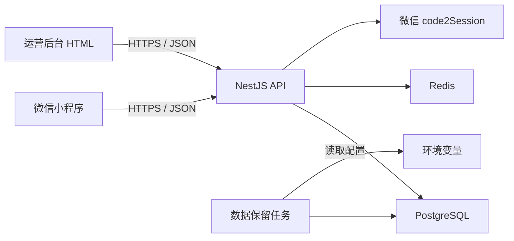
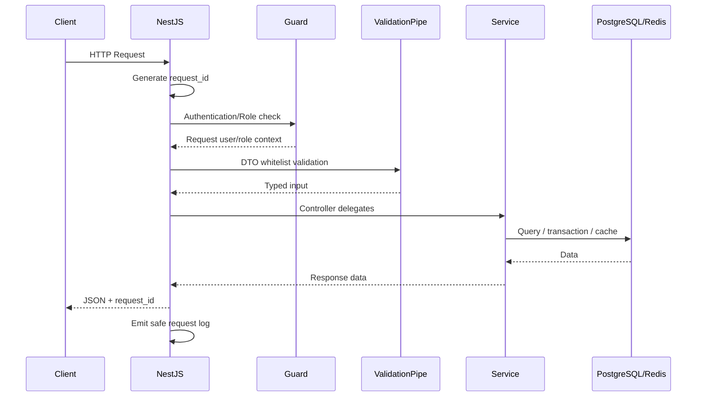
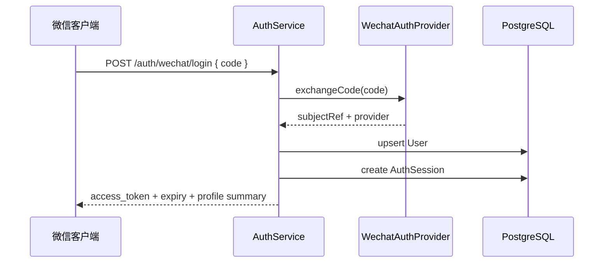
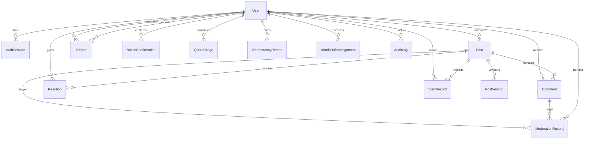
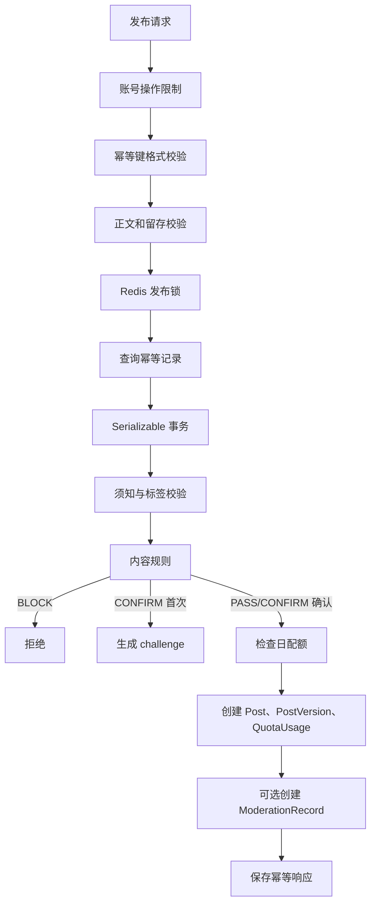

# JIJU 技术设计文档

## 文档控制

| 项目 | 内容 |
| --- | --- |
| 文档 ID | TECH-JIJU-001 |
| 版本 | 1.0 |
| 状态 | 技术基线 |
| 适用系统 | JIJU 微信小程序、NestJS API、运营后台 |
| 目标读者 | 前端、后端、测试、运维、安全与隐私评审人员 |
| 维护责任人 | 技术负责人 |
| 文档日期 | 2026-11-22 |

本文说明 JIJU 的运行时结构、模块职责、数据模型、关键流程、横切机制和技术边界。接口字段以 `docs/api.yaml` 为权威来源，实体约束以根目录 `domain.md` 为权威来源。

## 1. 文档目的与边界

### 1.1 目的

1. 说明系统由哪些运行组件组成，以及组件之间的依赖方向。
2. 说明代码目录、模块职责和请求处理链路。
3. 说明数据库实体、约束、索引和服务端关键规则。
4. 说明发布、评论、轻互动、举报、治理和账号注销的技术实现。
5. 说明幂等、并发、分页、时间、日志、测试和部署机制。
6. 为后续扩展、问题定位、代码评审和交接提供统一技术基线。

### 1.2 与其他文档的关系

| 文档 | 关系 |
| --- | --- |
| `ai-context.md` | 技术栈、目录和工程规则的上位约束 |
| `domain.md` | 实体与字段约束的权威定义 |
| `docs/api.yaml` | 对外接口契约的权威定义 |
| `docs/permissions.md` | 角色授权矩阵与服务端校验点 |
| `docs/state-machine.md` | 状态迁移和可见性规则 |
| `docs/errors.md` | 错误码、HTTP 状态和重试语义 |
| `docs/development-process.md` | 开发、测试、评审和交付流程 |
| `docs/data-model.md` | 面向接口实现的数据模型说明 |

## 2. 系统概览

JIJU 由一个原生微信小程序、一个 NestJS API 服务和两个数据存储组件组成。运营后台由 NestJS 服务直接提供 HTML 页面，不单独部署前端工程。



### 2.1 运行角色

| 角色 | 技术边界 |
| --- | --- |
| 游客 | 可读取广场、详情、评论和标签 |
| 普通用户 | 使用用户 Bearer 会话执行发布、评论、互动和举报 |
| 运营账号 | 使用独立后台 Bearer 会话和后台角色 |
| API 服务 | 负责协议、鉴权、业务规则、事务和数据访问 |
| PostgreSQL | 保存业务事实、约束、版本、配额、审计和会话 |
| Redis | 保存会话辅助状态、发布锁和风险确认 challenge |
| 数据保留任务 | 执行定期清理，不替代在线查询过滤 |

## 3. 技术栈

| 层级 | 当前技术 |
| --- | --- |
| 小程序 | 微信小程序原生框架、TypeScript |
| 小程序测试 | Vitest |
| API 框架 | NestJS 11 |
| 运行时 | Node.js 22+ |
| 数据访问 | Prisma 6 |
| 数据库 | PostgreSQL 16 |
| 缓存 | Redis 7、ioredis |
| 后端测试 | Jest、Supertest、Node.js Test Runner |
| 文档校验 | PowerShell 5+、Node.js |
| 本地编排 | Docker Compose |
| 运营后台 | NestJS Controller 返回内联 HTML、CSS 和 JavaScript |

## 4. 运行拓扑与部署

### 4.1 本地 Compose

`server/compose.yaml` 提供：

- PostgreSQL 16，宿主机 `5432`。
- Redis 7，宿主机 `6380`，容器内 `6379`。
- API 容器，宿主机 `3001`。
- PostgreSQL 数据卷 `jiju_postgres`。

Redis 使用宿主机 `6380` 是为了避免与常见的本机 Redis 服务冲突。Compose 内部的 API 仍通过 `redis:6379` 访问。

### 4.2 Docker 镜像

`server/Dockerfile` 使用多阶段构建：

1. `deps`：安装 npm 依赖。
2. `build`：复制 Prisma、Node 配置、源码和规则配置，生成 Prisma Client 并构建 NestJS。
3. `runtime`：仅复制生产运行必需的依赖、编译产物、Prisma 和配置。

容器启动顺序：

```text
prisma migrate deploy
prisma seed
node dist/src/main.js
```

### 4.3 进程内组件

| 组件 | 生命周期 |
| --- | --- |
| NestJS HTTP Server | 进程生命周期 |
| PrismaClient | NestJS Provider |
| Redis Client | NestJS Provider |
| 内容规则配置 | 首次读取后进程内缓存 |
| 发布 challenge | Redis，短期 TTL |

## 5. 代码结构与依赖方向

### 5.1 小程序

```text
frontend/
├─ miniprogram/
│  ├─ pages/              页面入口和页面级编排
│  ├─ components/         可复用展示组件
│  ├─ custom-tab-bar/     自定义底部导航
│  ├─ services/           API、会话和登录流程
│  ├─ utils/              草稿、字素簇、时间、幂等键
│  ├─ app.*               全局入口和样式
│  └─ types.ts            前端共享类型
└─ tests/                 前端测试
```

依赖方向：

```text
pages/components -> services -> wx.request
pages/components -> utils
services -> types
```

页面不得直接实现业务授权。服务端返回的权限提示只用于 UI，不构成授权依据。

### 5.2 服务端

```text
server/
├─ src/
│  ├─ <domain>/           controller、service、module、dto
│  ├─ admin-console/      后台 HTML 页面
│  ├─ common/             横切能力
│  ├─ config/             环境变量启动校验
│  ├─ content/            内容规则接口和实现
│  ├─ prisma/             PrismaService
│  └─ redis/              RedisService
├─ prisma/                schema、迁移、seed
├─ scripts/               数据保留任务
├─ config/                外置内容规则
└─ test/                 真实依赖集成测试
```

当前依赖方向：

```text
Controller -> Service -> PrismaService / RedisService
Controller -> DTO 校验
Service -> 领域规则、事务、幂等
PrismaService -> PostgreSQL
RedisService -> Redis
```

当前没有独立 Repository 类，领域 Service 直接调用 Prisma。若后续引入 Repository，必须放在对应领域模块内，并保持 Controller 不直接访问数据源。

## 6. 应用启动与配置

### 6.1 启动顺序

`server/src/main.ts` 执行：

1. 校验微信登录运行配置。
2. 创建 NestJS 应用。
3. 注册请求 ID 中间件。
4. 注册请求可观测性中间件。
5. 设置全局前缀 `/api/v1`。
6. 注册全局 ValidationPipe。
7. 注册全局异常过滤器。
8. 开启 Shutdown Hooks。
9. 监听 `0.0.0.0:PORT`，默认 `3001`。

### 6.2 环境变量

| 变量 | 用途 |
| --- | --- |
| `NODE_ENV` | 运行环境；`production` 时禁止 mock 微信登录 |
| `DATABASE_URL` | PostgreSQL 连接串 |
| `REDIS_URL` | Redis 连接串 |
| `PORT` | API 监听端口 |
| `NOTICE_VERSION` | 当前使用须知版本 |
| `CONTENT_RULES_FILE` | 内容规则文件路径 |
| `IDEMPOTENCY_TTL` | 幂等结果保留期 |
| `IDEMPOTENCY_LOCK_TTL` | 发布并发锁 TTL |
| `RISK_CHALLENGE_TTL` | 风险确认 challenge TTL |
| `ACCOUNT_DELETION_GRACE_HOURS` | 账号注销冷静期 |
| `EXPIRED_POST_BODY_RETENTION_DAYS` | 到期正文保留期 |
| `VIEW_RECORD_RETENTION_DAYS` | 浏览记录保留期 |
| `AUDIT_LOG_RETENTION_DAYS` | 审计日志保留期 |
| `MOCK_WECHAT_LOGIN` | 是否使用 mock 微信 provider |
| `WECHAT_APP_ID` | 正式微信 AppID |
| `WECHAT_APP_SECRET` | 正式微信 AppSecret |
| `SEED_DEMO_DATA` | seed 是否生成演示数据 |

### 6.3 微信配置校验

- `NODE_ENV=production` 且 `MOCK_WECHAT_LOGIN=true` 时启动失败。
- 关闭 mock 后，缺少 `WECHAT_APP_ID` 或 `WECHAT_APP_SECRET` 时启动失败。
- 正式 provider 使用微信 `code2Session`。
- `session_key` 不落库、不返回客户端、不进入日志。
- 微信身份只通过不可逆内部引用关联平台 User。

## 7. 请求处理链路



### 7.1 请求 ID

- 每个请求生成 `req_<uuid_v7>`。
- 响应头返回 `x-request-id`。
- 错误响应体返回 `request_id`。
- 日志只记录请求级白名单字段。

### 7.2 入参校验

全局 `ValidationPipe` 配置：

- `transform=true`
- `whitelist=true`
- `forbidNonWhitelisted=true`

未声明字段会被拒绝。校验失败统一返回：

```text
HTTP 422
code: JIJU_VALIDATION_4221
details.fields: 字段级安全提示
```

### 7.3 统一响应

成功响应通常包含：

```text
data
page（列表接口）
request_id
```

删除接口成功返回 `204`，无响应体。

## 8. 身份、会话与权限

### 8.1 普通用户登录



规则：

- 用户会话默认有效期 7 天。
- 客户端令牌格式为 `ses_...`。
- 数据库只保存令牌 SHA-256 哈希。
- 退出登录只撤销当前会话。
- 注销冷静期账号需要显式恢复参数。
- 平台昵称由内部算法生成，不公开微信昵称。

### 8.2 后台登录

- 后台使用用户名和密码。
- 密码只保存 scrypt 哈希。
- 后台会话默认有效期 8 小时。
- 后台会话与普通用户会话共用会话事实表，但使用独立角色校验。
- 登录成功写入 `ADMIN_LOGIN` 审计记录。

### 8.3 Guard

| Guard | 行为 |
| --- | --- |
| `SessionAuthGuard` | 强制要求有效 Bearer 用户会话 |
| `OptionalSessionAuthGuard` | 无 Authorization 时放行；存在但无效时拒绝 |
| `AdminRoleGuard` | 校验用户存在有效的后台角色分配 |

会话有效条件：

- 令牌哈希存在。
- 会话未撤销。
- 会话未过期。
- 用户账号状态为 `ACTIVE`。
- 用户不处于注销停用状态。

### 8.4 后台角色

- `REPORT_REVIEWER`
- `CONTENT_MODERATOR`
- `ACCOUNT_MODERATOR`
- `AUDITOR`
- `CONFIG_ADMIN`

角色分配必须 `active=true` 且 `revokedAt=null`。

### 8.5 操作限制

`assertActionAllowed` 在发布、评论和互动前检查：

- `postingRestrictedUntil`
- `commentingRestrictedUntil`
- `reactionRestrictedUntil`

限制仍有效时返回 `403 JIJU_ACCESS_4031`。

## 9. API 模块

API 根路径为 `/api/v1`。

### 9.1 用户端与公开接口

| 方法与路径 | 模块 | 说明 |
| --- | --- | --- |
| `POST /auth/wechat/login` | Auth | 微信登录 |
| `POST /auth/logout` | Auth | 撤销当前用户会话 |
| `GET /tags` | Tags | 公开标签目录 |
| `POST /notices/{version}/confirmations` | Notices | 确认使用须知 |
| `GET /feed` | Posts | 广场游标分页 |
| `GET /posts/{post_id}` | Posts | 帖子详情 |
| `POST /posts` | Posts | 发布帖子 |
| `PUT /posts/{post_id}` | Posts | 编辑本人帖子 |
| `DELETE /posts/{post_id}` | Posts | 删除本人帖子 |
| `GET /posts/{post_id}/comments` | Comments | 评论列表 |
| `POST /posts/{post_id}/comments` | Comments | 发布评论 |
| `DELETE /comments/{comment_id}` | Comments | 删除本人评论 |
| `PUT /posts/{post_id}/reaction` | Reactions | 设置或切换轻互动 |
| `DELETE /posts/{post_id}/reaction` | Reactions | 取消轻互动 |
| `GET /me/posts` | Me | 我的帖子 |
| `GET /me/profile` | Me | 当前用户资料 |
| `PUT /me/profile` | Me | 修改广场昵称 |
| `DELETE /me/account` | Me | 申请注销账号 |
| `POST /reports` | Reports | 提交举报 |

### 9.2 后台接口

| 方法与路径 | 说明 |
| --- | --- |
| `POST /admin/auth/login` | 后台登录 |
| `GET /admin/reports` | 举报队列 |
| `GET /admin/review-queue` | 举报与规则复核统一查询 |
| `GET /admin/content` | 内容治理列表 |
| `POST /admin/content/{type}/{id}/reviews` | 内容复核 |
| `POST /admin/content/{type}/{id}/actions` | 隐藏、下架和恢复 |
| `GET /admin/users` | 用户列表 |
| `POST /admin/users/{id}/restrictions` | 账号处置 |
| `GET /admin/audit-logs` | 审计查询 |
| `GET /admin-console` | 运营后台 HTML |
| `GET /admin-console/process` | 独立处理页 HTML |

字段、响应、错误码和幂等要求以 `docs/api.yaml` 为准。

## 10. 数据模型

### 10.1 实体总览



### 10.2 模型职责

| 模型 | 职责 |
| --- | --- |
| `User` | 平台身份、广场昵称、账号状态和操作限制 |
| `AdminCredential` | 后台用户名、密码哈希和启用状态 |
| `AdminRoleAssignment` | 后台角色及撤销状态 |
| `AuthSession` | 普通用户和后台会话令牌哈希、有效期 |
| `NoticeConfirmation` | 用户对指定须知版本的确认 |
| `TagCatalog` | 标签目录当前版本 |
| `Tag` | 情绪/情境标签、排序和启用状态 |
| `Post` | 帖子当前公开内容、状态、版本和到期 |
| `PostVersion` | 帖子不可变历史版本 |
| `Comment` | 评论内容、版本和审核状态 |
| `Reaction` | 用户对帖子的唯一轻互动状态 |
| `ViewRecord` | 以帖子与访问令牌去重的浏览记录 |
| `QuotaUsage` | 发帖日配额和评论滚动窗口配额 |
| `IdempotencyRecord` | 幂等键、请求指纹和首次响应 |
| `Report` | 用户举报及其提交时内容版本 |
| `ModerationRecord` | 人工复核记录与处理结果 |
| `AuditLog` | 治理、账号和登录操作审计 |

### 10.3 关键约束

- `Post.id`、`Comment.id`、`Reaction.id` 等使用业务前缀加 UUIDv7。
- `NoticeConfirmation(userId, noticeVersion)` 唯一。
- `Tag(category, name)` 唯一。
- `PostVersion(postId, versionNumber)` 唯一。
- `Reaction(userId, postId)` 唯一。
- `ViewRecord(postId, viewToken)` 唯一。
- `QuotaUsage(userId, quotaType, requestId)` 唯一。
- `QuotaUsage(userId, quotaType, sourceId)` 唯一。
- `IdempotencyRecord(actorId, operation, idempotencyKey)` 唯一。
- `ModerationRecord(targetType, targetId, contentVersion, reviewRound)` 唯一。
- `Report.dedupeKey` 唯一。

### 10.4 软删除

- 帖子使用 `publicStatus=DELETED` 和 `deletedAt`。
- 评论使用 `deletedAt`。
- 轻互动使用 `active=false`。
- 复核和审计记录不提供普通业务删除。

## 11. ID、时间与分页

### 11.1 ID

- 对外 ID 格式为 `<type>_<uuid_v7>`。
- UUIDv7 前 48 位写入毫秒时间戳。
- 版本位固定为 7，变体位符合 RFC 9562。
- 常见前缀：`usr_`、`pst_`、`pvr_`、`cmt_`、`rxn_`、`rpt_`、`mdr_`、`aud_`、`qtu_`、`idm_`。

### 11.2 时间

- 数据库和服务端采用 UTC。
- API 时间使用 RFC 3339 UTC 字符串。
- 面向用户展示时转换为 `Asia/Shanghai`。
- 发帖日配额按北京时间自然日计算。
- 评论配额使用连续 60 分钟窗口。
- 到期边界为 `server_now >= expires_at`。

### 11.3 游标分页

普通分页游标包含：

```json
{
  "version": 1,
  "timestamp": "2026-11-22T00:00:00.000Z",
  "id": "pst_..."
}
```

统一复核队列游标包含来源：

```json
{
  "version": 1,
  "source": "report",
  "queueAt": "2026-11-22T00:00:00.000Z",
  "itemId": "rpt_..."
}
```

游标使用 Base64URL 编码。客户端不得修改或解释游标。非法游标返回 `422`。

## 12. 文本、字素簇与内容规则

### 12.1 文本规范化

- 展示文本执行 `trim()`。
- 长度使用 `Intl.Segmenter` 按 Unicode 扩展字素簇计算。
- 帖子上限 500，评论上限 200。
- 不按 UTF-16 code unit 或字节数计算。
- 规则匹配前执行 NFKC、移除格式/控制字符并合并空白。
- 规则匹配规范化不改变数据库正文和展示正文。

### 12.2 内容规则

规则结果：

| 结果 | 行为 |
| --- | --- |
| `PASS` | 直接发布 |
| `CONFIRM` | 先确认风险提示，不落库 |
| `BLOCK` | 不创建内容、不消耗配额 |

判定优先级：

```text
BLOCK > CONFIRM > PASS
```

规则配置：

- 文件：`server/config/content-rules.json`
- 支持 `contains` 和 `regex`
- 支持规则 ID、提示版本和资源版本
- 首次读取后进程内缓存
- 当前文件仍使用演示规则，不能视为正式内容标准

### 12.3 CONFIRM 两阶段

1. 首次返回 `409 JIJU_MODERATION_4092`。
2. Redis 保存短期 challenge。
3. 重试时携带 `risk_challenge_id` 和 `risk_acknowledged=true`。
4. challenge 校验用户、内容指纹、提示版本和有效期。
5. 发布后审核状态为 `PENDING`，写入复核记录。
6. 成功后消费 challenge。

## 13. 广场与帖子详情

### 13.1 广场

- 只返回 `PUBLISHED`、未删除、未隐藏、未到期内容。
- 审核状态必须是 `PASSED`，或 `PENDING` 且存在 `riskConfirmedAt`。
- 按 `publishedAt DESC, id DESC` 稳定排序。
- 正文摘要最多 120 个扩展字素簇。
- 评论与轻互动使用聚合查询批量计数。
- 广场永不返回 `view_count`。

### 13.2 详情可见性

非作者可见条件：

```text
publicStatus == PUBLISHED
AND hiddenAt == null
AND deletedAt == null
AND expiresAt > now
AND (
  moderationStatus == PASSED
  OR (moderationStatus == PENDING AND riskConfirmedAt != null)
)
```

非作者访问到期、隐藏、删除或不存在内容统一返回 `404 JIJU_CONTENT_4041`。

作者可读取已到期或隐藏的本人内容，但不能读取已删除内容。

### 13.3 浏览量

- 只有作者详情返回 `view_count`。
- 作者本人访问不写浏览记录。
- 非作者必须携带 `X-View-Token`。
- Token 格式为 `v1:<uuid_v7>`。
- `(postId, viewToken)` 唯一。
- `createMany(skipDuplicates=true)` 处理重复打开。
- 广场、评论和我的帖子不返回浏览量。

## 14. 发布帖子

### 14.1 流程



### 14.2 配额

- 每用户每北京时间自然日最多 5 篇。
- 仅成功发布写入 `QuotaUsage`。
- `BLOCK`、校验失败和首次 `CONFIRM` 不消耗配额。
- 删除帖子不返还配额。

### 14.3 幂等

- 必须携带 `Idempotency-Key`。
- 操作名为 `post.publish`。
- Redis 锁防止并发首次写入。
- 数据库唯一约束防止重复幂等记录。
- 同键同指纹返回首次响应。
- 同键不同指纹返回 `409`。

## 15. 编辑、删除与内容版本

### 15.1 编辑

- 仅作者可操作。
- 必须提交 `expected_content_version`。
- 至少提供一个可编辑字段。
- 正文、标签、须知和内容规则重新校验。
- 新版本写入 `PostVersion`。
- 当前内容和 `currentContentVersion` 原子更新。
- `published_at` 和 `expires_at` 不变。
- 高风险编辑重新进入 `PENDING`。
- 已删除、到期或审核拒绝内容不可编辑。

### 15.2 删除

- 仅作者可操作。
- 状态设置为 `DELETED` 并写入 `deletedAt`。
- 已删除内容不进入广场、详情和我的帖子。
- 删除后不返还配额。
- 删除操作幂等。

## 16. 评论

### 16.1 列表

- 仅对公开可用帖子开放。
- 按 `publishedAt ASC, id ASC` 稳定分页。
- 排除已删除评论。
- 展示 `PASSED` 和 `PENDING` 评论。
- 登录用户获得服务端计算的 `can_delete`。

### 16.2 发布

- 必须登录、确认须知且未被限制评论。
- 正文 1～200 个扩展字素簇。
- 连续 60 分钟最多成功评论 10 条。
- 第 11 条返回 `429 JIJU_QUOTA_4292`。
- `BLOCK` 不创建评论。
- `CONFIRM` 创建 `PENDING` 评论并进入复核。
- 成功评论、配额和幂等响应在同一 Serializable 事务内提交。

### 16.3 删除

- 仅评论作者可以删除。
- 使用 `deletedAt` 软删除。
- 删除幂等，不重复产生副作用。

## 17. 轻互动

### 17.1 类型

```text
HUG        抱一抱
HEAD_PAT   摸摸头
CHEER      握拳
```

### 17.2 唯一性

数据库唯一约束：

```text
Reaction(userId, postId)
```

同一用户对同一帖子最多只有一条记录：

- 首次设置：创建记录，`active=true`。
- 切换类型：更新同一记录。
- 取消：设置 `active=false`。
- 再次设置：恢复并更新同一记录。

### 17.3 并发

- 使用 Serializable 事务。
- 遇到 `P2002` 时读取幂等结果。
- 遇到 `P2034` 时最多重试 3 次。
- 计数按 `active=true` 分组聚合，不维护易漂移的冗余总数。

## 18. 举报与复核队列

### 18.1 举报提交

- 举报人必须登录和确认须知。
- 只能举报 Post 或 Comment。
- 不能举报自己的内容。
- 服务端捕获被举报对象当前 `contentVersion`。
- `OTHER` 说明必填且只在后台可见。
- 同一用户、对象、原因 24 小时内业务去重。
- `Idempotency-Key` 防止同一请求重放。
- 举报成功只返回举报 ID 和时间。

### 18.2 统一队列

来源：

```text
report      用户举报
moderation  规则复核
```

排序：

```text
queueAt ASC
source rank: report before moderation
itemId ASC
```

跨来源分页使用包含 `source`、`queueAt` 和 `itemId` 的不透明游标，避免同时间戳丢项或重复。

队列不返回：

- 正文
- 评论正文
- 举报说明
- 浏览量
- 浏览者身份

### 18.3 人工复核

- 只能处理当前版本或举报保存版本。
- `expected_content_version` 不匹配返回 `409`。
- 通过：审核状态 `PASSED`。
- 拒绝：审核状态 `REJECTED`；帖子公开状态转为 `HIDDEN`。
- 举报按保存版本结案。
- 写入 `ModerationRecord` 和 `AuditLog`。

## 19. 内容治理

### 19.1 动作

| 动作 | 行为 |
| --- | --- |
| `HIDE` | 帖子公开状态转为 `HIDDEN` |
| `TAKEDOWN` | 帖子公开状态转为 `HIDDEN` |
| `RESTORE` | `HIDDEN -> PUBLISHED` |

### 19.2 RESTORE 条件

- 后台运营角色。
- 当前状态为 `HIDDEN`。
- 未删除。
- `server_now < expires_at`。
- 审核状态不是 `REJECTED`。
- 必须记录原因、操作人、时间和前后状态。
- 不修改 `expires_at`。

### 19.3 终态

- 删除、到期和审核拒绝内容不提供无效处理入口。
- 已处理举报显示“已处理”，不再显示操作按钮。

## 20. 账号处置与审计

### 20.1 账号动作

- 警告
- 限制发帖
- 限制评论
- 限制互动
- 封禁账号

限制类动作必须提供未来时间。警告不使用结束时间。

### 20.2 审计日志

记录字段：

- 操作人
- 操作角色
- 动作
- 对象类型和 ID
- 内容版本
- 操作前后状态
- 原因
- `request_id`
- 操作时间

典型动作：

- `ADMIN_LOGIN`
- `REVIEW_PASSED`
- `REVIEW_REJECTED`
- `HIDE`
- `TAKEDOWN`
- `RESTORE`
- `WARNING`
- `POST_LIMIT`
- `COMMENT_LIMIT`
- `REACTION_LIMIT`
- `BAN`
- `ACCOUNT_DELETE_REQUESTED`

审计日志不可由普通业务删除，默认保留 180 天。

## 21. 账号注销与数据保留

### 21.1 注销

- 必须提交确认文本。
- 账号立即变为 `DEACTIVATED`。
- 撤销全部普通会话。
- 作者帖子转为 `HIDDEN`。
- 评论软删除。
- 互动取消。
- 写入审计记录。
- 默认提供 30 天恢复窗口。

### 21.2 数据保留任务

`npm run retention:run` 执行：

- 清理超过保留期的浏览记录。
- 清理超过保留期的审计日志。
- 清理过期幂等记录。
- 清理过期或已撤销会话。
- 清理到期帖子正文。
- 处理到期注销账号。

在线查询仍必须自行过滤状态和到期时间，不依赖任务实时执行。

## 22. 错误处理

### 22.1 错误结构

```json
{
  "code": "JIJU_VALIDATION_4221",
  "message": "内容不符合要求，请修改后重试",
  "request_id": "req_...",
  "details": {
    "fields": {
      "body_text": "正文不能为空"
    }
  }
}
```

### 22.2 异常映射

- `ApiError` 使用显式业务码和状态。
- NestJS `HttpException` 映射为稳定公共错误。
- 未知异常统一映射为 `503 JIJU_SYSTEM_5031`。
- 不向客户端返回堆栈、SQL、内部主机或规则原文。

### 22.3 不可用内容

非作者访问到期、隐藏、删除或不存在内容统一返回：

```text
404
JIJU_CONTENT_4041
内容已不可用
```

## 23. 日志、埋点与隐私

### 23.1 请求日志

只允许字段：

- `request_id`
- `trace_id`
- `route_template`
- `method`
- `status_code`
- `duration_ms`
- `result_category`
- `actor_ref`
- `operation`

### 23.2 禁止记录

- 帖子正文
- 评论正文
- 举报说明
- 微信昵称或头像
- `openid`
- `unionid`
- `session_key`
- 用户令牌
- 手机号
- 证件号
- IP
- 精确位置
- 完整查询参数
- 密钥

### 23.3 错误定位

- 用户只收到 `request_id`。
- 排查时使用请求日志和审计记录。
- 错误日志不得把请求体整体序列化。

## 24. 小程序技术设计

### 24.1 页面

- `feed`：广场
- `detail`：帖子详情、评论、互动和作者操作
- `publish`：草稿、登录恢复、标签、留存和风险确认
- `edit`：作者编辑
- `my`：用户中心
- `my-posts`：我的帖子
- `profile`：个人资料
- `settings`：账号设置
- `login`：登录和须知
- `notice`：使用须知
- `report`：举报

### 24.2 会话

- 使用 `wx.getStorageSync` 保存平台会话。
- 启动和页面访问时校验令牌与到期时间。
- 损坏或过期会话自动清理。
- 不保存微信 openid、unionid 或 session_key。
- 退出登录返回广场。

### 24.3 草稿

- 游客可先编辑。
- 登录中断返回后保留正文、标签、留存和原操作意图。
- 草稿只保存本地必要字段。
- 发布成功后清理本地草稿。

### 24.4 网络错误

- HTTP 非 2xx 转换为 `ApiRequestError`。
- 客户端网络失败使用 `NETWORK_ERROR`。
- 401 自动引导重新登录。
- 服务端错误保留 `request_id` 供排查。

### 24.5 UI 约束

- 三选项按钮使用可收缩 flex 布局。
- 长文本安全换行。
- 摘要明确行数省略。
- 公开属性使用勾选框。
- 不展示内部 ID、技术错误码或开发说明。

## 25. 运营后台技术设计

### 25.1 形态

- 由 NestJS 返回单页 HTML。
- CSS 和 JavaScript 内联在页面模块中。
- 页面启用 CSP 和 `no-store` 缓存策略。
- 后台会话保存在 `sessionStorage`。

### 25.2 工作区

- 左侧导航。
- 顶部栏。
- 可关闭工作标签。
- 处理页通过 iframe 打开。
- 关闭标签即关闭对应处理页。

### 25.3 筛选与列表

- 举报、队列、内容、用户和审计均使用结构化控件。
- 审计筛选使用中文下拉，不要求输入内部枚举。
- 长文本显示省略号和完整 tooltip。
- 不展示内部对象 ID。
- 终态记录不显示无效操作。

### 25.4 反馈

- 成功、失败和状态冲突使用明确弹窗或状态提示。
- 后台错误不直接展示数据库或堆栈信息。
- 会话失效后返回后台登录页。

## 26. 状态组合

帖子公开状态：

```text
PUBLISHED
HIDDEN
EXPIRED
DELETED
```

审核状态：

```text
PASSED
PENDING
REJECTED
```

公开可见组合：

```text
PUBLISHED + PASSED
PUBLISHED + PENDING + riskConfirmedAt != null
```

非法组合：

- `PENDING` 无风险确认仍公开。
- `REJECTED` 仍公开。
- 到期后继续公开。
- 删除后恢复。
- 非后台角色执行审核或治理迁移。

## 27. 数据库迁移与索引

### 27.1 迁移策略

- Prisma schema 是开发模型。
- 迁移文件是数据库演进事实。
- 已交付环境的迁移不直接改写。
- 字段删除需要兼容迁移和备份。
- 新迁移必须能在已有测试数据库执行。

### 27.2 主要索引

- 广场：`publishedAt DESC, id DESC`。
- 到期查询：`expiresAt` 与公开状态联合索引。
- 评论：`postId, publishedAt, id`。
- 反应：`postId, type, active` 和 `(userId, postId)` 唯一。
- 举报：`status, submittedAt, id` 和对象版本索引。
- 复核：`status, createdAt, id` 和对象版本索引。
- 审计：对象、操作人、动作类型与时间索引。
- 幂等：`expiresAt` 索引和用户+操作+键唯一。

## 28. 测试架构

### 28.1 测试层级

| 类型 | 位置 |
| --- | --- |
| 后端单元 | `server/src/**/*.spec.ts` |
| 真实依赖集成 | `server/test/` |
| 小程序单元 | `frontend/tests/` |
| 生产 API 契约 | `tests/acceptance/` |
| 性能 | `tests/performance/` |
| 综合验证 | `tests/production/` |
| 文档和结构 | `tests/docs/`、`tests/structure/` |

### 28.2 重点覆盖

- 未登录和会话失效。
- 非作者与作者权限。
- 500/501 字素边界。
- 零宽字符绕过。
- 到期后详情、评论和互动拒绝。
- 发布、评论和举报幂等。
- 轻互动数据库唯一约束。
- 游标分页不重复。
- 后台角色和终态操作。
- 日志和埋点不含敏感正文。

### 28.3 验证入口

```powershell
powershell -NoProfile -ExecutionPolicy Bypass -File tests/production/Verify-Production.ps1
```

真实 PostgreSQL/Redis 集成测试必须设置专用环境并显式启用，skip 不计为通过。

## 29. 本地开发与构建

### 29.1 后端

```powershell
cd server
Copy-Item .env.example .env
npm ci
npm run prisma:generate
npm run prisma:migrate
npm run prisma:seed
npm start
```

### 29.2 小程序

1. 用微信开发者工具导入 `frontend/`。
2. 配置本地 AppID。
3. 修改 `frontend/miniprogram/app.ts` 中的 `apiBaseUrl`。
4. 手机与电脑使用同一局域网。

### 29.3 构建

```powershell
cd server
npm run build
```

```powershell
cd frontend
npm run typecheck
npm test
```

## 30. 已知边界与扩展约束

### 30.1 当前边界

- 正式微信凭据和真机链路未在仓库内配置。
- 内容规则目前只有演示标记。
- 真实 PostgreSQL/Redis 集成依赖专用环境。
- 生产域名和平台审核不属于仓库代码。
- 不包含图片、语音、视频和 AI 自动审核。

### 30.2 扩展规则

- 新接口必须先进入 PRD 和 OpenAPI。
- 新数据表必须同步领域模型和迁移。
- 新后台功能必须定义角色、审计和终态。
- 新日志字段必须经过隐私评审。
- 新依赖必须获得批准。
- 新增客户端判断不得替代服务端授权。
- 所有扩展必须同时补充 AC、测试和回滚考虑。
